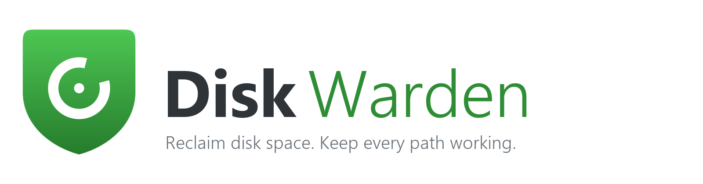

<p align="center">
  <picture>
    <source media="(prefers-color-scheme: dark)" srcset="ui/assets/brand/logo-wordmark-dark.png">
    
  </picture>
</p>

# Disk Warden

English | [Chinese](README.zh-CN.md)

**Disk Warden** is a storage manager for AI coding tools. It finds the data directories of Cursor, Trae, Claude Code and other AI IDEs on your machine, moves the reproducible bulk (caches, indexes, logs) to another drive, and keeps the original paths working — so your system drive stops filling up.

**Windows** builds are available today. **macOS** (11+, Apple Silicon) builds are produced unsigned by CI: see [First launch on macOS](#first-launch-on-macos).

## Download and install

Ready-to-run packages, one click, no toolchain: open the [**Releases page**](https://github.com/QuotaFuse-ai/disk-warden/releases/latest) and download the archive for your platform. There is nothing to compile and no Python to install — each zip already contains the complete app.

| Platform | File | What to do |
|---|---|---|
| Windows 10 / 11 x64 | `DiskWarden-0.9.0-beta.10-win-x64.zip` | Unzip to a fixed folder **on the C: drive** (e.g. `C:\DiskWarden`), then run `DiskWarden\DiskWarden.exe`. |
| macOS 11+ (Apple Silicon) | `DiskWarden-0.9.0-beta.10-macos-arm64.zip` | Unzip, open `DiskWarden.app`, allow it once — see [First launch on macOS](#first-launch-on-macos). |

Each archive ships with a matching `.sha256` file and a `START-HERE*.txt` guide in the zip root.

**Windows: keep the app on the C: drive.** Unpack into a fixed folder on your system drive — `C:\DiskWarden` is the recommended path — and start it from there. Do not run it from inside the zip preview, from `Downloads` after a "run without extracting", from a temporary folder, from a USB stick or from a network share: those locations are read-only, disappear, or change path between launches, and the junctions the app creates when it moves a directory would break. Program data, settings and logs are stored outside the app folder, so replacing the app later never touches them.

**What has been verified.**

- **Windows** — built and exercised on Windows 10/11: the full unit suite, the packaged sandbox drills, and the frozen executable's self-check all run on the released artifact.
- **macOS** — **not tested on real hardware yet.** Nobody on the team has a Mac, so the `.app` is built by GitHub Actions on `macos-latest` and only passes an automated `--smoke` self-check (bundle layout, WKWebView backend, UI files present). Treat it as a developer preview: the packaging is verified, the click-through is not. Please report anything that breaks in an issue.

Both builds are **unsigned**: Windows shows a SmartScreen prompt on first run (More info → Run anyway), macOS asks for Gatekeeper approval once. Neither warning is a virus alert, and neither requires switching off a system protection.

The interface starts in **English**; the `中文` / `EN` chip in the title bar switches the whole app to Simplified Chinese, and the choice is remembered.

## Is it safe?

You no longer need to clone this repository to use Disk Warden — download the archive from Releases and verify it:

- Every archive has a `.sha256` asset next to it. Compare `Get-FileHash -Algorithm SHA256` (PowerShell) or `shasum -a 256` with that value before running anything.
- The repository tracks **no compiled binaries**. Everything users execute is produced by `packaging/build.ps1` or the macOS CI job from a tagged commit and attached to a release.
- `python tools/repo_safety_check.py` audits the tracked tree offline: committed credentials, download-and-run or obfuscated scripts, destructive deletes, unexpected outbound hosts, symlinks, disguised executables, and archive path traversal. It executes and uploads nothing.
- The latest result is committed in [`docs/security/repo-safety-report.md`](docs/security/repo-safety-report.md); the full policy, app behaviour and reporting process are in [`SECURITY.md`](SECURITY.md).

## Why not just a cleanup tool

- It understands AI IDE directory layouts and classifies each directory as **movable**, **do-not-touch**, or **unknown** — instead of deleting files by extension
- After a move, the original path becomes a link (junction on Windows, symlink on macOS); IDEs and shells keep working unchanged
- Every move is backed up first and verified afterwards; any failure rolls back, and the source data is never the only copy at risk
- Migrated directories can be rolled back with one click; interrupted migrations are recovered automatically on next start
- Optional online AI analysis for unknown directories only — **off by default**

## Status

| Capability | Status |
|---|---|
| Directory scan, size accounting, risk classification (T06–T08) | Done |
| Copy, verification, link creation, crash recovery (T09–T10) | Done |
| Rollback engine and local store: journal / history / settings / learned rules (T11) | Done, merged to `main` |
| AI analysis interface (T22) | Done, disabled by default |
| UI wired to the real engine, AI key setup (T12, T25) | Done, merged to `main` |
| Welcome screen, GitHub sign-in and star prompt (T16) | In progress: GitHub Device Flow; skipping sign-in never limits local features |
| Windows packaging (T15) | Published as `DiskWarden-0.9.0-beta.10-win-x64.zip`: tray, per-user autostart, rotating logs, packaged sandbox drills |
| macOS adaptation and packaging (T21) | Published as `DiskWarden-0.9.0-beta.10-macos-arm64.zip`, **untested on real hardware**: `.app` built on GitHub Actions `macos-latest`, symlink transfer/links, LaunchAgent autostart, tray, rotating logs, in-app first-launch guide; CI builds and smoke-tests the bundle |

**934 unit tests** cover the completed modules; CI runs them on every push.

## Platforms

- **Windows 10/11** — primary development and verification platform. The core engine is implemented: robocopy transfer, `mklink /J` links, process-in-use detection, volume and free-space checks.
- **macOS 11+ (Apple Silicon)** — in scope for the first release (decision 0004). Everything platform-specific lives in `src/platform/mac/`: `rsync`/`cp` transfer, `ln -s` symlinks with target read-back, volume and free-space checks, process detection, and a per-user LaunchAgent for autostart. The unsigned `.app` is built on GitHub Actions `macos-latest` (decision 0007); Intel Macs need a separate x64 build, which is not produced yet.
  - **Known gap in 0.9.0-beta:** automatic discovery (`data/ide-catalog.json` + `src/core/scan/discovery.py`) is still Windows-only, so the scan finds nothing on a Mac and the list comes up empty. The app, tray, autostart, logs, and the migration engine itself are in place; a macOS catalog is a follow-up task.

## First launch on macOS

The 0.9.0-beta macOS build is **not signed or notarized**, so Gatekeeper stops the first launch once. Signing plus notarization is the real fix; whether to pay for it is still a human decision. Until then:

1. Unzip the whole archive to a fixed folder and open `DiskWarden.app` (shown as “Disk Warden” in Finder).
2. Allow it, depending on the macOS version:
   - **macOS 15 (Sequoia) and newer** — right-click → Open no longer bypasses the block. Try to open the app, dismiss the dialog, then go to **System Settings → Privacy & Security**, scroll to **Security**, click **Open Anyway** for Disk Warden, authenticate, and confirm.
   - **macOS 13 (Ventura) – 14 (Sonoma)** — Control-click (or right-click) the app → **Open**, then click **Open** again in the dialog.
3. The app shows the same steps the first time it starts, and **Settings → First-launch guide** reopens them at any time.

Only if those steps do not work, the advanced escape hatch is `xattr -dr com.apple.quarantine "/Applications/Disk Warden.app"`. It removes the quarantine flag from the whole bundle — it disables the source check for that app and does nothing to fix the missing signature. The same instructions ship in the zip root as `START-HERE-macOS.txt` (source: `packaging/START-HERE-macOS.txt`).

Data lives in `~/Library/Application Support/DiskWarden` (`logs/app.log` below it); autostart is a LaunchAgent at `~/Library/LaunchAgents/com.quotafuse.diskwarden.plist` and takes effect at the next login.

## Stack

- Python 3.12 as the official build toolchain (decision 0012); the test suite runs on 3.10 and 3.12 in CI
- UI: a single self-contained HTML/JS page (`ui/index.html`) hosted by pywebview (WebView2 on Windows, WKWebView on macOS)
- Packaging: PyInstaller 6 onedir; macOS artifacts built in CI

## Development

Requires Python 3.10 or newer.

```bash
# Full unit test suite
python -m unittest discover -s tests -q

# Migration drills: sandboxed in the system temp directory, never touch real user data
python tools/migrate_drill.py
python tools/migrate_drill_b.py

# View the UI prototype: static page with sample data
# Open ui/index.html in a browser
```

The desktop app runs from source with `python -m src.app.main`, or from the unsigned Windows zip produced by `packaging/build.ps1`. The macOS `.app` is built by `packaging/build-macos.sh` on a Mac or by the `build-macos` workflow in CI. `main.py` is the early Tkinter experiment, kept for reference only.

## Layout

```
src/
  core/scan/       directory scanning and enumeration
  core/rules/      rule engine and risk classification
  core/migrate/    migration: backup, copy, verify, link, crash recovery
  core/rollback/   rollback: preflight, execution, recovery
  core/store/      local store: journal, history, settings, learned rules, logs
  core/ai/         AI analysis interface (off by default)
  platform/        platform adapters: win / mac / posix
data/              IDE catalog and rule data
ui/                static UI prototype
docs/              requirements, decisions, specs, task outputs
tests/             unit tests
tools/             drills and validation scripts
```

## Documentation

1. [Product requirements](docs/功能需求.md)
2. [IDE directory catalog](docs/目录清单.md) — data behind the rule engine
3. [Product spec](docs/specs/产品规格-v1.0.md) — acceptance criteria and safety invariants
4. [Architecture](docs/specs/架构设计-v1.0.md) — modules, interfaces and data flow
5. [UI interaction spec](docs/specs/界面交互说明-v1.0.md) — screens and interaction rules

## License

[PolyForm Noncommercial License 1.0.0](LICENSE). Copyright (c) 2026 huangtao. Free for personal, study, research and nonprofit use. **Any commercial use — including internal use by a company — requires a separate commercial license.** Contact 44062290+QuotaFuse-ai@users.noreply.github.com.

This is a source-available license, not an OSI-approved open-source license.

## Safety and privacy

- Migration copies only; the source is never recursively deleted. Deletion targets verified copies and stale links only
- Dangerous directories (IDE installations, user source code) are blocked from migration; yellow-tier directories require explicit confirmation
- AI analysis is off by default. When enabled, directory information is sent to a third-party AI service, and the UI says so before you turn it on
- No credentials are tracked. Tokens the app obtains at runtime are stored with the OS keychain (DPAPI on Windows) and never written to the repository; local scratch scripts are gitignored. `tools/repo_safety_check.py` fails the build if a secret pattern ever lands in a tracked file

## Contributing

- Open an issue first; report outputs and risks in the issue comment when done
- Keep one logical change per commit and use conventional commit messages
