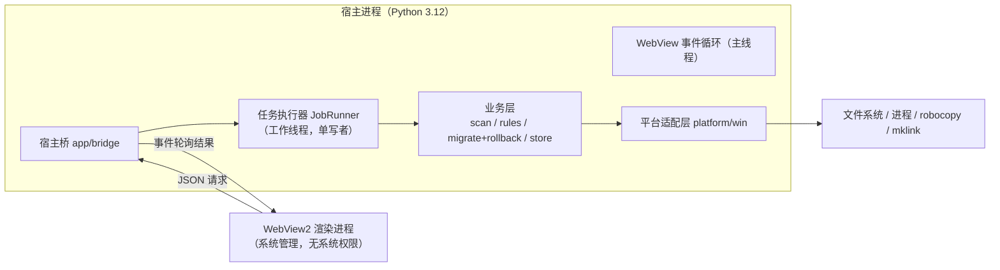
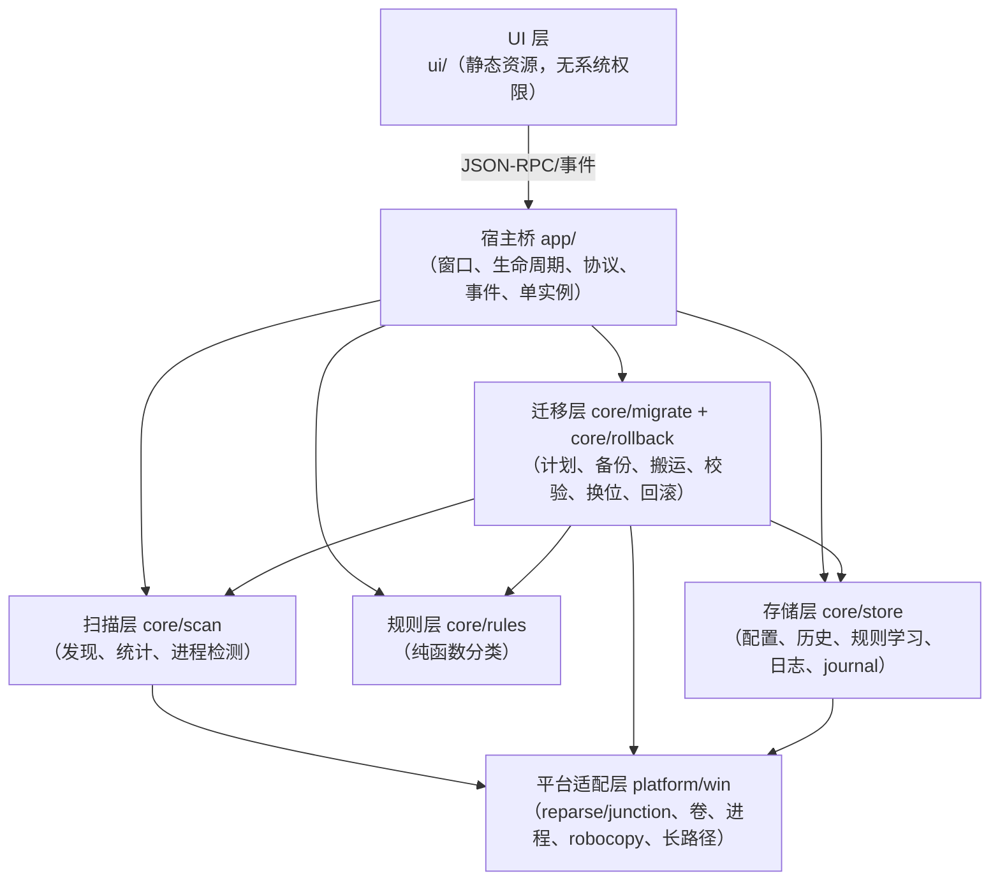
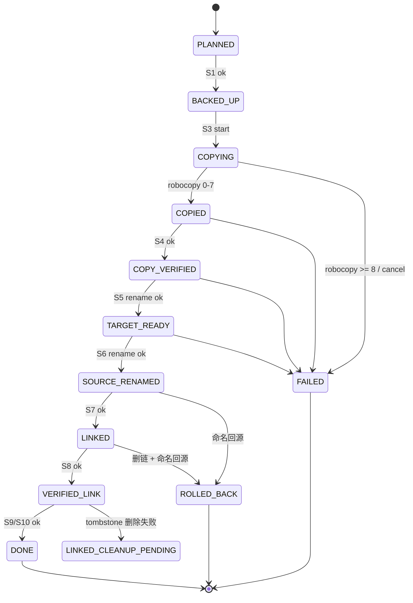

# Disk Warden 架构设计 v1.0

> 版本：v1.0（选型待人类确认，确认后冻结为 v1.0-final）
> 日期：2026-10-19
> 作者：后端架构师
> 任务：QUOT-4 / T02
> 上游依据：`docs/功能需求.md` v0.1、`docs/specs/产品规格-v1.0.md`、`docs/目录清单.md`
> 范围：设计和选型，不含实现代码。Windows 第一期（P0）为目标平台，Mac 只保留扩展点。

---

## 0. 结论摘要

1. **运行时外壳选 A：Python 3.12 + pywebview（系统 WebView2）+ PyInstaller（onedir）+ Inno Setup。**
   Electron + React 被否决，核心原因是这个产品是"系统操作密集型"而非"界面密集型"：安装包约为 Electron 方案的 1/3，冷启动快约 1 倍，junction / 进程枚举 / robocopy 全部可由标准库直接、可控地完成，且删除链接的语义已在本机实测验证。
2. **UI 框架与宿主选型正交。** P0 沿用现有 `ui/index.html`（原生 JS）以控制风险；P1 若界面复杂度上升，可独立引入 Vite + React 构建成静态资源，由 pywebview 加载，不需要因此改选 Electron。
3. **系统分为五层**：扫描 / 规则 / 迁移（含回滚）/ 存储 / UI。依赖方向单向：UI → 宿主桥 → 业务层 → 平台适配层；规则层是纯函数，不碰磁盘；UI 层不允许直接访问文件系统。
4. **迁移安全的核心设计**是"重命名换位"而不是"删除后建链"：校验通过后先把源目录原子重命名为同目录下的 tombstone，再在原位建 junction，验证通过后才异步清理 tombstone。这样最关键的一步是可逆的 O(1) 重命名，而不是几十 GB 的递归删除。
5. **每个迁移步骤都是 `ensure_*` 语义，可重入、可恢复**；任务日志（journal）按"先记意图、再执行、后记结果"落盘，应用崩溃后按"状态 + 实际文件系统观测"决策，绝不凭状态字段盲删。
6. **与决策 0001 不冲突**：0001 的 P0 主链路、优先级和"实现类任务等选型确认后启动"全部保持不变；本设计只是在其模块划分上补充了 `src/app`（宿主桥）与 `src/platform`（系统适配）两个非业务目录，并把 `src/migrate` 与 `src/rollback` 归入同一个"迁移层"。

---

## 1. 背景、约束与设计原则

### 1.1 需要解决的冲突

| 来源 | 说法 | 本设计如何处理 |
|---|---|---|
| `docs/功能需求.md` 第 4 章 | Python 3.12 + HTML + PyInstaller | 采用。与产品能力最匹配 |
| 团队/项目背景说明 | React + Electron，官网 + hub + dsk | 判定为通用模板描述（`项目现状总结` §4 已给出同样结论），不作为技术依据；三端范围见决策 0003 待确认项 |
| `main.py` | Python + Tkinter 空壳 | 废弃，不进入新架构；UI 统一为 WebView |
| `ui/index.html` | 浏览器静态原型 | 保留为 P0 的 UI 起点 |

### 1.2 产品约束（直接决定架构）

- **破坏性操作**：迁移会动 `%APPDATA%` / `%USERPROFILE%` 下的真实数据，删源或链接错误等于用户数据丢失。正确性 > 可回滚性 > 简单 > 界面表现。
- **系统能力密集**：目录枚举、递归统计、进程检测、robocopy、junction 创建/读取/删除、磁盘与文件系统类型查询、长路径、权限错误处理。
- **离线优先、无账号**：不上传任何数据；不引入云端依赖（AI 分析未知目录为 P1/P2 且需人类确认）。
- **Windows 先行、Mac 后续**：Windows 是唯一 P0 平台；Mac 的成本只要可估算、可延后即可。
- **绿色软件、低权限**：`mklink /J` 不需要管理员权限，产品不应请求提权。
- **交付形态**：单文件/单目录可执行程序 + 托盘 + 开机自启（P1）。

### 1.3 设计原则

1. **单向依赖、接口先行**：层与层之间只通过数据模型和接口通信，便于 T04/T06~T12 并行。
2. **UI 不持有系统权限**：UI 只能提交"对某个扫描条目的操作意图"，由宿主解析真实路径，防止被篡改的页面执行任意路径操作。
3. **所有破坏性步骤可重入**：每个步骤都先检查前置条件，重复执行结果一致。
4. **宁可失败，不可误删**：任何校验不通过都保持源数据不动；不确定时停下来交给用户。
5. **可观测性内置**：每个任务有 journal，每个失败有错误码，每个操作有日志，诊断信息可一键导出。

---

## 2. 运行时外壳选型

### 2.1 对比口径

- 体积、内存、启动为**工程估算**（Electron 取当前主流版本，Python 取 3.12 + pywebview 5.x + PyInstaller onedir），需在 T15 前的 0.5 人日 spike 中实测校准。
- 本机实测：裸解释器启动 Python 36 ms、Node 30 ms，差异可忽略；**真正的启动差异来自浏览器引擎**（系统 WebView2 vs 自带 Chromium）。
- 本机实测（Python 3.8.6，Windows 10）：junction 的 `os.path.islink()` 返回 False，但 `st_file_attributes & FILE_ATTRIBUTE_REPARSE_POINT` 为真、`st_reparse_tag == 0xA0000003`，`os.readlink()` 可读出目标（带 `\\?\` 前缀），`os.rmdir()` 只删除链接、目标目录内容完好。

### 2.2 量化对比

| 维度 | A：Python 3.12 + pywebview + PyInstaller | B：Electron + React | 说明 |
|---|---|---|---|
| 安装包体积 | **25~40 MB** | 90~130 MB | B 自带 Chromium；A 复用系统 WebView2 |
| 安装后磁盘占用 | **70~110 MB**（onedir） | 250~350 MB | A 的 onefile 更小但冷启动更慢，不推荐 |
| 冷启动（SSD，典型笔记本） | **0.6~1.2 s**（onedir）；onefile 1.5~3 s | 1.5~3.0 s | 差异来自浏览器引擎初始化 |
| 常驻内存（RSS 粗估） | **90~160 MB** | 220~400 MB | 均含渲染进程 |
| 冷启动/首次运行前置条件 | 需检测 WebView2；Win11 与已更新 Win10 通常自带 | 无外部运行时 | WebView2 缺失时用 bootstrapper 或明确提示 |
| Windows 系统 API 调用 | **标准库直连**：`os.scandir`、`os.rename`、`os.rmdir`、`os.readlink`、`ctypes`、`subprocess`；进程枚举用 psutil | 需 `child_process` + `tasklist`/PowerShell CIM；进程枚举无标准库，原生 addon 有 ABI 维护风险 | WMIC 已在 Windows 11 后续版本默认移除 |
| 进程枚举耗时（全量） | **50~200 ms**（psutil） | 400~1200 ms（PowerShell CIM）或引入原生模块 | 扫描每次刷新都会用到 |
| junction 处理 | 创建/读取/删除均在标准库或 `mklink` 覆盖；**本机已实测删除链接不伤目标** | 通过 `cmd /c mklink` 创建；删除与递归删除的语义依赖 libuv，必须额外做破坏性测试 | 这是 P0 最高风险点 |
| robocopy 搬运 | `subprocess` + 退出码判定，与 B 相同 | `child_process`，与 A 相同 | 外部进程，性能一致 |
| UI 开发效率 | 与 B 相当（都能加载同一套静态/React 构建产物） | 与 A 相当；自带打包与更新工具链 | UI 框架不构成选型理由 |
| 系统能力开发效率 | **高**：Python 团队、psutil、ctypes 现成 | 需 Node↔系统桥接或 Python sidecar | 产品工作量主要在系统层 |
| 跨平台成本 | Mac 需替换平台适配（WKWebView、`ditto`、`ln -s`），约 3~5 人日 | 工程同构，命令仍需分平台，约 2~4 人日 | 差异 1~2 人日，且 Mac 是 P2 |
| 安全面 | **小**：单主进程、只加载本地静态页面 | 需正确配置 `contextIsolation` / `sandbox` / CSP / 窄 IPC；配置错误后果重 | 两套都可做对，A 的默认面更小 |
| 打包与签名 | PyInstaller + Inno Setup，均可签名 | electron-builder，生态更成熟 | 都不做自动更新（P2） |
| 团队匹配 | 后端/主机端偏 Python；前端仍可写 React | 名义上匹配 React/Electron | 背景说明被判定为模板，见 §1.1 |
| 故障可控性 | 步骤边界清晰、可单测、单进程可 attach | 多进程 + IPC + 原生模块，故障面更大 | 破坏性工具优先可控 |

### 2.3 明确推荐：方案 A

理由（按权重排序）：

1. **产品本质是系统工具。** 扫描、校验、搬运、建链、回滚是全部核心工作量；界面只有 5 个 Tab、一个详情页和几个弹窗。用 100 MB 的 Chromium 来承载这点 UI 不划算。
2. **安全边界更可控。** 删源与建链的每一步都可以在 Python 里做前置检查（reparse point 标记、重解析标签、目标卷类型、精确路径匹配）。本机已实测 `os.rmdir` 对 junction 只删链接；而 Node 侧需要先证明 libuv 的递归删除语义，验证成本更高。
3. **体积和启动是用户可感知的差异。** 安装包约为 B 的 1/3，冷启动约快 1 倍，对"偶尔打开清一下 C 盘"的工具型产品很重要。
4. **React 不是 B 的独占优势。** UI 可以用 Vite + React 构建成纯静态资源，pywebview 直接加载；宿主选谁不影响前端技术栈。这条直接抵消了团队栈层面的顾虑。
5. **与现有文档、模块命名和下游任务一致。** 需求文档第 4 章、决策 0001 的 `src/*` 模块划分都是按 Python 写的，选 A 不需要改需求、不产生返工。
6. **风险最低。** 不引入 Node 原生模块，不打包两份运行时，不需要维护宿主与 sidecar 之间的生命周期与协议。

**否决 B 的理由**：B 的唯一实质优势是复杂前端工程化和自动更新生态，而本项目 P0/P1 的界面复杂度低、明确不做自动更新（P2），且团队的真实能力在系统层。用 B 会把"系统 API 调用"变成"Node 桥接 + 原生模块/子进程"的二次封装，增加的是风险而不是价值。

**如果人类坚持 B**：本设计的五层边界、数据模型、迁移状态机和 UI 协议可以原样复用，只需替换 `src/app`（宿主桥）和 `src/platform`（系统适配）的实现，业务层可作为 Python sidecar 保留。这也是本设计刻意把"业务逻辑"与"宿主外壳"解耦的原因。

### 2.4 方案 A 的前置条件与风险

| 项 | 结论 | 处置 |
|---|---|---|
| Python 版本 | 设计基线 **3.12**（`os.path.isjunction` 于 3.12 加入） | 当前开发机只有 3.8.6，需安装 3.12；构建/CI 统一 3.12 |
| 低版本兼容 | 若必须兼容 3.8，可用 `st_file_attributes + st_reparse_tag == 0xA0000003` 判定 junction（本机实测可行） | 平台适配层内部封装，业务层不感知 |
| WebView2 | Win11 / 已更新的 Win10 通常自带 | 安装器检测；缺失时引导安装或提示，不静默失败 |
| pywebview Windows 后端 | 依赖 WebView2 与 pythonnet，PyInstaller 需正确收集 | T15 前做打包 spike，锁定版本 |
| PyInstaller 杀软误报 | onefile 偶发误报、启动慢 | 使用 onedir + Inno Setup；发布前做多引擎扫描，后续代码签名 |
| 长路径（>260） | Python 需 `\\?\` 前缀；robocopy 原生支持 | 平台适配层统一规范化；计划阶段对超长路径给出明确阻断 |
| 目标盘文件系统 | junction 只支持本地 NTFS | 计划阶段校验卷类型与文件系统，exFAT/FAT32/网络盘直接阻断 |

---

## 3. 总体架构

### 3.1 进程与线程模型



- **一个宿主进程**；WebView2 渲染进程由系统管理。
- **主线程只跑 UI 事件循环**，绝不执行扫描/搬运等长任务。
- **任务执行器**：所有长任务以 job 形式提交到工作线程；P0 只允许 **一个写任务**（迁移/回滚）同时运行，扫描与迁移互斥，避免 UI 与磁盘竞争和状态交错。
- **宿主桥不阻塞**：启动类方法立即返回 `job_id`，进度通过"事件缓冲 + 轮询"获取（见 §5）。

### 3.2 分层图



**五层与目录的对应关系**：

| 层 | 目录 | 说明 |
|---|---|---|
| UI 层 | `ui/`（渲染侧）+ `app/`（宿主侧） | 渲染侧无系统权限；宿主侧负责窗口、协议、任务调度 |
| 扫描层 | `core/scan/` | |
| 规则层 | `core/rules/` | |
| 迁移层 | `core/migrate/` + `core/rollback/` | 回滚与迁移共用模型与 journal |
| 存储层 | `core/store/` | |
| （基础设施，不属于五层） | `platform/` | 五层共享的 Windows 适配；不承载业务逻辑 |

**允许的依赖**：`ui → app`、`app → {scan, rules, migrate, rollback, store}`、`migrate/rollback → {scan(process), rules, store, platform}`、`scan/rules/store → platform`。

**禁止的依赖**：`scan` 不得调用 `rules`（扫描只产出事实，不判定安全等级）；`rules` 不得访问文件系统或存储（输入由调用方注入）；业务层不得导入 UI 或 `app`；`store` 不得包含业务判断。

### 3.3 建议目录结构（在决策 0001 基础上的最小补充）

```
src/
├── app/                # 宿主桥、窗口、托盘(P1)、单实例、协议分发、事件缓冲
│   ├── main.py         # 入口
│   ├── bridge.py       # rpc 方法注册与参数校验
│   └── jobs.py         # JobRunner、取消令牌、进度节流
├── core/
│   ├── scan/           # T06/T08：枚举、大小、进程
│   ├── rules/          # T07：catalog + pattern + learned，纯函数
│   ├── migrate/        # T09/T10：plan、backup、copy、verify、swap、link
│   ├── rollback/       # T11：回滚状态机（与 migrate 共用模型和 journal）
│   ├── store/          # T11：settings/history/rules-learned/logs/journal，原子写
│   └── models.py       # 跨层数据模型与错误码（唯一共享契约）
├── platform/
│   └── win/            # junction、卷类型、进程、robocopy、长路径
└── ui/                 # 静态资源；P0 用 ui/index.html 搬迁而来
data/                   # T03 产出：ide-catalog.json、rules.json
tools/                  # 校验脚本等
tests/                  # 单测 + 集成 + 故障注入
```

> 与 0001 的关系：0001 列的 `src/scan`、`src/rules`、`src/migrate`、`src/rollback`、`src/store` 全部保留，只是在 `src/core/` 下归位；`src/app` 与 `src/platform` 是本次新增的非业务目录，不改变 0001 的 P0 范围和优先级（见决策 0003 §4）。

---

## 4. 五层模块边界与接口

本节的数据模型与接口是 T04/T06~T12 的**并行开发契约**。字段可以在实现时增加可选字段，但不得改变已有字段语义。

### 4.1 跨层数据模型（`src/core/models.py`）

```text
ScanItem
  item_id: str              # sha256(tool_id + "\n" + 规范化 rel_path) 前 16 位；跨扫描稳定
  tool_id: str              # 如 "cursor"、"claude-code"
  source_path: str          # 绝对路径，规范化（真实大小写、无反斜杠歧义）
  rel_path: str             # 相对工具根，正斜杠分隔，用于规则匹配和日志
  kind: "dir" | "file"
  bytes: int
  file_count: int
  is_reparse: bool          # 目录本身是 junction/symlink 时为真（不进入统计）
  access_errors: int        # 统计时被拒绝的子项数；>0 表示大小可能偏小
  mtime_max: str            # ISO8601，用于计划阶段发现"扫描后又被写"的情况

ToolNode
  tool_id, display_name, category("ide"|"cli"|"plugin"|"tool")
  roots: list[str]          # 该工具命中的所有数据根（新旧目录可能并存）
  process_names: list[str]  # 来自 catalog，用于占用检测
  exe_paths: list[str]      # 已知可执行路径（可选）
  items: list[ScanItem]

ScanReport
  scan_id, started_at, finished_at, roots: list[str]
  tools: list[ToolNode]
  warnings: list[Warning]   # 权限不足、路径不存在、reparse 跳过等

Classification
  item_id
  safety: "green" | "yellow" | "red"
  source: "catalog" | "learned" | "pattern" | "unknown"
  rule_id: str
  reason_key: str           # i18n key，不在核心层写死中文/英文
  requires_confirm: bool    # yellow 恒为 true；red 恒为 false（不可操作）

ClassifiedItem = ScanItem + Classification

MigrationPlan
  plan_id, created_at, expires_at        # confirm_token 有效期 5 分钟
  mode: "migrate" | "prestage" | "rollback"
  target_root: str
  actions: list[PlanAction]              # 每个 item 一条
  totals: {bytes, files}
  space: {target_free, required, after_est}
  blocks: list[Block]                    # 非空则不可执行
  warnings: list[Warning]
  confirm_token: str                     # 与 plan 内容哈希绑定，start 时校验

MigrationJob
  job_id, type("migrate"|"rollback"|"scan"), state, mode
  items: list[JobItem]
  step: str                  # 见 §6.4 状态机
  progress: {bytes_done, bytes_total, files_done, files_total, step_started_at}
  error: Error | None
  journal_version: int
  created_at, updated_at
```

### 4.2 扫描层（`core/scan`）

| 项 | 定义 |
|---|---|
| 职责 | 枚举根目录与已知工具、列出数据条目、递归统计大小、检测占用进程、上报可取消进度 |
| 不负责 | 安全等级判定（交给规则层）、可否迁移的决策（交给迁移层）、写任何文件 |
| 输入 | 扫描根列表（默认 `%APPDATA%`、`%LOCALAPPDATA%`、`%USERPROFILE%`、`%USERPROFILE%\.local\share`，P1 增加项目目录）；已知工具清单（来自 catalog，由 app 注入） |
| 输出 | `ScanReport`，以及进度事件 |
| 依赖 | 平台适配层（目录枚举、进程枚举）；不依赖规则层与存储层 |

接口：

```text
discover(tools, roots) -> list[ToolCandidate]
  # 1) catalog 命中：只做存在性检查，不递归
  # 2) 规则发现：在根下单层扫描，按目录名/特征匹配（P0 只做已知工具，不做未知工具发现）
  # 去重：Windows 路径大小写不敏感；跳过 reparse point，避免双计与环

measure(items, cancel_token, progress_cb) -> list[ScanItem]
  # 迭代式 os.scandir，不用递归；不跟随 reparse point；权限错误计入 access_errors 并继续
  # 进度节流到 4 次/秒；取消在目录边界生效（<=100ms）

detect_processes(tools) -> dict[tool_id, ProcessHit]
  # psutil：先按进程名，再按可执行文件路径；返回 pid/name/exe，供 UI 展示

scan(roots, cancel_token, progress_cb) -> ScanReport
```

约束与指标：

- **不跟随 reparse point**：否则会重复计算、循环、甚至遍历到已迁移的数据。
- 扫描根不存在时跳过并写 warning，不报错中断。
- 目标：SSD 上 20 万文件、50 GB 数据的元数据扫描 ≤ 15 s；UI 全程可响应、可取消。
- 扫描结果是**快照**：迁移前由迁移层重新校验条目当前状态，不盲信扫描时的大小。

### 4.3 规则层（`core/rules`）

| 项 | 定义 |
|---|---|
| 职责 | 把 `ScanItem` 分为 green / yellow / red，给出规则来源与原因 key |
| 不负责 | 发现目录、统计大小、访问文件系统（catalog 由调用方加载后传入） |
| 输入 | `ScanItem` + catalog（T03 的 `ide-catalog.json`）+ pattern 规则（`rules.json`）+ 本地学习记录 |
| 输出 | `Classification` |
| 依赖 | 无（纯函数）；catalog 的数据结构由 T03 按本契约提供 |

优先级（高 → 低）：

1. **catalog 精确命中**：工具 + 规范化相对路径（支持 glob），来源 `catalog`。
2. **本地学习**：用户对同一 `item_id` 的决定，来源 `learned`。
3. **名称/特征规则**：`Cache`、`GPUCache`、`logs`、`sessions`、`*.sqlite` 等，来源 `pattern`。
4. **兜底**：`yellow` + `unknown`，`requires_confirm = true`。

硬约束：

- **red 不可被任何学习规则或模式规则覆盖**。`settings.json`、`Login Data`、`Local State`、`*.credentials*`、`auth.json`、`memory/` 等命中 red 即终态。
- **yellow 永远需要显式确认**（`confirm_yellow_ids`）才能进入计划；确认只对本次计划有效，不自动写入学习记录。
- 规则的 `reason_key` 是 i18n key（如 `rule.reason.chromium_cache`），核心层不出现面向用户的中文文案。
- 学习规则只能把 green 降为 red、把 yellow 升为 green 或降为 red；不允许把 red 升为 green/yellow。
- "迁完未回滚 → 自动绿色"的判定放在规则层之外（由 app/history 计算）：同一 `item_id` 成功迁移且 **7 天内无回滚**，才写入 learned-green。具体天数待产品确认（见决策 0003）。

### 4.4 迁移层（`core/migrate` + `core/rollback`）

| 项 | 定义 |
|---|---|
| 职责 | 生成计划、空间与前置校验、备份配置、搬运、校验、源目录换位、建链、验证、清理、回滚、进度、journal |
| 不负责 | 安全分类（只消费 Classification）、界面展示、发现工具（消费 ScanReport） |
| 输入 | `item_ids`（来自最近一次扫描）、`target_root`、`mode`、确认 token |
| 输出 | `MigrationPlan` / `MigrationJob` / 事件 / 历史记录 |
| 依赖 | 扫描层（重新检测进程）、规则层（重新分类）、存储层（journal/history/backup）、平台适配层 |

核心接口：

```text
plan(item_ids, target_root, mode, confirm_yellow_ids, scan_snapshot) -> MigrationPlan
start(plan_id, confirm_token) -> job_id
cancel(job_id) -> bool                 # 只在可取消边界生效
status(job_id) -> MigrationJob
recover_pending() -> list[RecoveryAction]   # 启动时调用
rollback_plan(job_id | item_ids) -> RollbackPlan
rollback_start(plan_id, confirm_token) -> job_id
```

计划阶段的阻断码（任一命中则 `blocks` 非空，禁止执行）：

| 代码 | 触发条件 |
|---|---|
| `BLOCKED_PROCESS` | 目标工具的进程正在运行 |
| `BLOCKED_RED_PATH` | 条目分类为 red |
| `YELLOW_NOT_CONFIRMED` | 条目为 yellow 且未在 `confirm_yellow_ids` 中 |
| `TARGET_INSUFFICIENT` | 目标可用空间 < 条目字节 × 1.05 + 64 MB |
| `TARGET_NOT_NTFS` | 目标卷不是本地 NTFS（exFAT/FAT32/网络盘均阻断） |
| `TARGET_UNAVAILABLE` | 目标路径不存在、不可写或盘符掉线 |
| `TARGET_INSIDE_SOURCE` | 目标路径位于源目录内部，或与源目录相同 |
| `SOURCE_INVALID` | 源不存在、已是 junction、或已被迁移 |
| `ALREADY_MIGRATED` | 该条目已完成迁移（非回滚模式） |
| `LONG_PATH` | 目标路径或任一侧子路径超过 240 字符 |
| `JOB_CONFLICT` | 同一条目有进行中的任务，或已有写任务在运行 |
| `SCAN_STALE` | 扫描快照与当前文件系统明显不符（大小/mtime 变化），需重新扫描 |

平台适配层（`platform/win`）对外只暴露以下原语，业务层不直接调 `subprocess`/`ctypes`：

```text
is_reparse_point(path) -> bool
is_junction(path) -> bool                    # 3.12 用 os.path.isjunction；低版本用 reparse tag
create_junction(link_path, target_path)      # 内部可用 mklink /J 或 DeviceIoControl
read_junction_target(path) -> str | None     # 规范化去掉 \\?\ 前缀
remove_junction(path)                        # 仅当确认是 reparse point 且指向预期目标
remove_tree(path, ownership)                 # ownership = {job8, kind, created_by_job}；
                                             # 进入前校验路径/命名/卷，且根不是 reparse point；
                                             # 内部遇到 reparse point 只删链接，绝不递归进入目标
volume_info(path) -> {fs_name, drive_type, free_bytes, total_bytes}
rename_dir(src, dst)                         # 同卷原子重命名；跨卷直接报错
run_robocopy(src, dst, log_path, cancel_token) -> exit_code
enumerate_processes() -> list[ProcessInfo]
```

### 4.5 存储层（`core/store`）

| 项 | 定义 |
|---|---|
| 职责 | 数据的读写、schema 版本、原子写、备份轮转、日志、journal 持久化 |
| 不负责 | 任何业务判断（不决定什么该迁移、什么该学习） |
| 依赖 | 平台适配层（文件锁、路径、原子替换） |

数据布局（遵循需求文档 4.2，新增 journal 与 bootstrap 指针）：

```
<data_root>/                        # 默认 D:\DiskWarden\
├── data/<tool_id>/<rel_path>       # 迁移后的真实数据
├── backup/<yyyy-MM-dd_HHmmss>_<tool_id>_<job8>/
│   ├── manifest.json               # 备份清单：源路径、文件、大小、哈希
│   └── files/...                   # 仅配置文件（KB 级）
├── logs/<yyyy-MM-dd>.log           # 结构化文本（JSONL 行），14 天轮转
├── config/
│   ├── settings.json               # schema_version + 用户设置
│   ├── rules-learned.json
│   ├── history.json                # 上限 5000 条，超出归档为 history-<yyyy-MM>.json
│   ├── migration-jobs/<job_id>.json  # 迁移/回滚 journal（安全关键）
│   └── locales/{en,zh-CN}.json
└── staging/                        # 可选；默认与最终目标同卷的 .dw-* 临时目录
```

**bootstrap 指针**（需求文档没有、但必须有）：数据根目录可被用户修改，且可能位于可移动磁盘；如果配置只存在于 `<data_root>/config`，盘符掉线后应用就失去自己的设置。因此在 `%LOCALAPPDATA%\DiskWarden\bootstrap.json` 保存 `{schema_version, data_root, updated_at}`。启动顺序：读 bootstrap → 校验根目录可写 → 读 settings；根目录不可用时进入"只读降级模式"（可扫描、不可迁移），并提示用户重新指定根目录。此补充已列入决策 0003 待确认项。

约束：

- **原子写**：同目录写 `*.tmp-<pid>` → `flush + os.fsync` → `os.replace`；settings 保留一份 `.bak`。
- **单实例**：命名互斥量；第二个实例只激活已有窗口后退出，避免两个进程同时写 journal。
- **journal 先意图后结果**：见 §6.4。`migration-jobs/` 下的文件是崩溃恢复的唯一依据，不能只写日志。
- **data_root 变更限制**：存在已迁移条目（`data/` 非空）时禁止直接改根目录；必须先全部回滚，或走 P1 的"根目录搬迁"专用流程。否则 junction 会全部失效。
- **时间**：所有时间戳 ISO8601 UTC；正确性判断不依赖时间（只用文件数/字节数/路径集合）。
- **编码**：UTF-8 无 BOM；JSON 写入 `ensure_ascii=False`。

### 4.6 UI 层与宿主桥（`ui/` + `app/`）

| 项 | 定义 |
|---|---|
| UI 职责 | 渲染扫描结果、计划预览、进度、错误、历史；收集用户意图；不直接访问文件系统 |
| 宿主桥职责 | 窗口生命周期、单实例、协议分发与校验、任务调度、事件缓冲、i18n 资源加载 |
| 安全边界 | 只加载本地静态资源；禁用外部导航；桥接方法白名单；**UI 只提交 `item_id`，不提交可执行的文件系统路径** |
| 依赖 | 业务层与存储层；不被任何业务层导入 |

UI 状态（T04 需覆盖）：`idle`、`scanning`、`scan_ready`、`plan_ready`、`migrating`、`failed`、`rolled_back`，外加空态与进程占用态。UI 只做展示与确认，所有阻断判断以宿主返回的 `blocks` 为准（前端校验仅为体验，不作为安全边界）。

---

## 5. UI ↔ 宿主通信协议（v1）

### 5.1 传输与封装

- UI 侧通过 pywebview 暴露的单一入口调用：`window.pywebview.api.rpc(requestJson) -> responseJson`。
- 所有请求与响应都是 **JSON 字符串**，由宿主统一做 schema 校验；不使用"每个方法一个 Python 函数"的散装暴露方式，避免遗漏校验。
- 长任务一律"提交 → 返回 job_id → 轮询/事件"，桥接调用本身不阻塞 UI。

请求：

```json
{
  "v": 1,
  "id": "req-7f3a",
  "method": "plan.preview",
  "params": {
    "item_ids": ["a1b2c3d4e5f60718"],
    "target_root": "D:\\DiskWarden",
    "mode": "migrate",
    "confirm_yellow_ids": []
  }
}
```

响应：

```json
{ "v": 1, "id": "req-7f3a", "ok": true, "result": { "plan_id": "plan-...", "blocks": [], "totals": { "bytes": 9021234567, "files": 152340 } } }
```

```json
{ "v": 1, "id": "req-7f3a", "ok": false,
  "error": { "code": "BLOCKED_PROCESS", "message_key": "error.blocked_process", "detail": { "tool_id": "cursor", "pids": [1234] }, "retryable": true } }
```

### 5.2 方法表（v1）

| 方法 | 参数 | 返回 | 说明 |
|---|---|---|---|
| `app.hello` | — | `{app_version, protocol_version, platform, data_root, locale}` | 启动握手；版本不兼容时 UI 提示升级 |
| `settings.get` | — | `{settings}` | |
| `settings.set` | `{patch}` | `{settings, applied}` | 校验类型与取值；data_root 受限（§4.5） |
| `scan.start` | `{roots?}` | `{job_id}` | 与迁移互斥；已有写任务时返回 `BUSY` |
| `scan.cancel` | `{job_id}` | `{cancelled}` | |
| `scan.status` | `{job_id}` | `{state, progress}` | 轮询用；不返回全量列表 |
| `scan.result` | `{scan_id, tool_id?}` | `{tools, warnings}` | 列表按工具分页；条目含分类结果 |
| `items.list` | `{scan_id, tool_id}` | `{items}` | 详情页分项 |
| `plan.preview` | `{item_ids, target_root, mode, confirm_yellow_ids}` | `{plan}` 或 error | 只读；生成 confirm_token |
| `migrate.start` | `{plan_id, confirm_token}` | `{job_id}` | token 与计划内容绑定、5 分钟过期 |
| `job.status` | `{job_id}` | `{job, recent_events?}` | 权威状态 |
| `job.cancel` | `{job_id}` | `{accepted}` | 仅在可取消边界生效 |
| `job.list` | `{active_only}` | `{jobs}` | 启动时恢复未完成任务 |
| `rollback.preview` | `{job_id? , item_ids?}` | `{plan}` | |
| `rollback.start` | `{plan_id, confirm_token}` | `{job_id}` | |
| `history.list` | `{cursor, limit}` | `{items, next_cursor}` | |
| `rules.learned.list` | — | `{entries}` | 规则学习页（P1） |
| `rules.override` | `{item_id, safety, note?}` | `{ok}` | 只允许 green↔red / yellow→green/red，red 不可解 |
| `diagnostics.generate` | — | `{text}` | 复制到剪贴板由 UI 完成 |
| `events.poll` | `{since_seq}` | `{events, next_seq}` | 权威增量；见 §5.3 |
| `shell.reveal` | `{item_id, which: "source"\|"target"}` | `{}` | 宿主解析路径；不接受任意路径 |
| `auth.start` | `{provider: "github"\|"gitee"}` | `{job_id}` | P1，本地回调 |

### 5.3 事件与进度

- 宿主把事件写入有界环形缓冲（上限 500 条），每条带单调递增 `seq`。
- UI 在任务进行中每 250 ms 调 `events.poll(since_seq)`；拿到事件后更新界面。**轮询是权威来源**，丢失事件只会导致一次刷新延迟。
- 宿主可用 `evaluate_js("window.dwNotify && window.dwNotify()")` 做无载荷的"有新事件"提示，优化响应速度；**任何数据都不通过字符串拼接进入 JS**，避免注入。
- 进度节流：宿主最多 4 次/秒；UI 不逐事件重排长列表。

事件表：

| 事件 | 载荷 | 用途 |
|---|---|---|
| `scan.progress` | `{job_id, phase, files_done, bytes_done}` | 扫描进度条 |
| `scan.done` | `{job_id, scan_id, summary}` | 刷新列表 |
| `job.state` | `{job_id, state, step}` | 状态机推进 |
| `job.progress` | `{job_id, step, bytes_done, files_done, files_total}` | 迁移进度 |
| `job.warning` | `{job_id, code, message_key, detail}` | 非致命告警（权限不足等） |
| `job.done` | `{job_id, state, summary}` | 终态：成功/失败/已回滚 |
| `job.recovery_needed` | `{job_id, action, detail}` | 启动时发现未完成任务 |

### 5.4 错误码（核心层 → UI）

| 代码 | 可重试 | 场景 |
|---|---|---|
| `INVALID_ARGUMENT` | 否 | 参数缺失/类型错误/非法 item_id |
| `NOT_FOUND` | 否 | job、plan、条目不存在 |
| `BUSY` | 是 | 已有写任务或扫描在运行 |
| `JOB_CONFLICT` | 否 | 同一条目重复任务 |
| `BLOCKED_PROCESS` | 是 | IDE 正在运行 |
| `BLOCKED_RED_PATH` | 否 | 命中不可动路径 |
| `INSUFFICIENT_SPACE` | 是 | 目标空间不足 |
| `TARGET_NOT_NTFS` | 否 | 目标卷不支持 junction |
| `PERMISSION_DENIED` | 是 | 文件被占用或权限不足 |
| `IO_ERROR` | 是 | 磁盘 I/O 错误 |
| `VERIFY_FAILED` | 是 | 数量/字节/路径集合不一致 |
| `LINK_FAILED` | 是 | junction 创建或读回失败 |
| `ROLLBACK_FAILED` | 否 | 回滚失败，已停止自动操作，需人工介入 |
| `RECOVERY_REQUIRED` | 否 | 发现崩溃残留，需用户确认恢复动作 |
| `INTERNAL` | 否 | 未预期错误（附诊断 id） |

约定：`message_key` 由 UI 本地化；`detail` 只放结构化数据（pid、路径、数字），不放面向用户的整句文案。

### 5.5 安全约束

1. **路径不出 UI**：所有文件操作只接受 `item_id` / `job_id` / `plan_id`，宿主从自己的快照和 journal 解析真实路径。即使渲染进程被注入，也无法驱动对任意路径的删除或建链。
2. **只加载本地资源**：`file://` 本地目录；禁止远程 URL、禁止新窗口导航；发布版关闭 devtools。
3. **CSP**：`default-src 'self'; script-src 'self'; img-src 'self' data:; style-src 'self' 'unsafe-inline'`（内联样式仅为现有原型的兼容，构建期可收紧）。
4. **白名单方法**：`rpc` 只分发 §5.2 表中的方法；未知方法返回 `INVALID_ARGUMENT` 并记录审计日志。
5. **确认令牌**：`migrate.start` / `rollback.start` 必须携带与计划内容哈希绑定的 token，防止 UI 预览和执行的不是同一份计划。
6. **单实例 + 单写者**：从进程模型上消除并发破坏。

---

## 6. 迁移引擎：失败点、回滚点与幂等

### 6.1 安全不变量（任何实现不得违反）

1. **源数据在校验通过前只读**：复制阶段绝不修改源目录。
2. **校验不通过绝不删源**：数量、字节、路径集合任一不一致即失败。
3. **删源前先换位**：不是"递归删除源目录"，而是"同卷原子重命名为 tombstone"；失败时重命名回来。
4. **建链并验证成功前不清理 tombstone。**
5. **回滚是先复制校验、后清理目标**，与正向迁移对称。
6. **任何删除都只针对 journal 记录的精确路径**，且删除前确认命名模式、所在卷、是否为 reparse point（该删链接时）。
7. **不跟随 reparse point** 做统计、复制或删除；robocopy 使用 `/XJ`。
8. **进程占用在复制前和换位前各检查一次**；第二次命中则中止并清理临时副本，源不动。

### 6.2 目标布局与命名

```
源：C:\Users\<u>\AppData\Roaming\Cursor\Cache
目标最终：D:\DiskWarden\data\cursor\Cache
目标暂存：D:\DiskWarden\data\cursor\.dw-partial-<job8>\Cache
源 tombstone：C:\Users\<u>\AppData\Roaming\Cursor\.dwtombstone-<job8>
```

- 暂存目录与最终目标**同卷**，成功后用 `os.rename` 原子改名。
- tombstone 与源目录**同父目录、同卷**，重命名为 O(1)。
- `<job8>` 是 job_id 前 8 位；清理时严格校验该模式，避免误删用户同名目录。

### 6.3 步骤与失败回滚点

| 步 | 动作 | 失败时文件系统状态 | 回滚动作 | 数据风险 |
|---|---|---|---|---|
| S0 | 计划与前置校验（进程、空间、NTFS、red、路径） | 未写入 | 无 | 无 |
| S1 | 备份配置到 `backup/<ts>_<tool>_<job8>/`（manifest + 文件） | 可能有不完整备份目录 | 删除该备份目录（仅本次命名）；源不动 | 无 |
| S2 | 创建目标暂存父目录 | 空目录 | 删除空暂存目录 | 无 |
| S3 | robocopy `/E` 复制到暂存（`/XJ`，有界重试） | 部分副本；源不动 | 删除暂存目录；源不动 | 无 |
| S4 | 校验：路径集合 + 每文件大小 + 文件数 + 总字节 | 完整副本；源不动 | 删除暂存；报 `VERIFY_FAILED` | 无 |
| S5 | 暂存目录原子改名为最终目标（同卷） | 最终目标就位；源不动 | 删除最终目标（刚由本 job 创建） | 无（源仍在） |
| S6 | 再次检查进程；**源目录原子改名为 tombstone** | 源路径空缺；数据在 tombstone | 命名回源路径；删除最终目标 | 无（数据始终存在） |
| S7 | 在源路径创建 junction → 最终目标 | 链接可能已建/未建 | 见 §6.5 崩溃矩阵 | 极低 |
| S8 | 验证链接：`read_junction_target` 规范化后等于最终目标 + 探测读取一个已知文件 | 链接异常 | 仅当链接指向本 job 目标时删除链接，tombstone 改回原名；最终目标保留不删 | 无 |
| S9 | 异步删除 tombstone（递归，但只针对精确路径） | tombstone 残留 | 标记 `LINKED_CLEANUP_PENDING`，启动时重试 | 无（重复数据，安全） |
| S10 | 写 history、写 learned 候选、更新 job 为 DONE | 记录可能未写 | 启动时从链接实际状态补记 | 无 |

**关键窗口**是 S6→S8：源路径短暂不存在。该窗口内源数据始终存在于 tombstone 或最终目标之一，最坏情况是"两份拷贝"，绝不是"没有数据"。

### 6.4 状态机与 journal



Journal 每条记录包含：`state`、`step`、`intent`（本步将要操作的精确路径，包括 source/final/staging/tombstone/backup）、`result`（退出码、计数）、`updated_at`。写顺序固定为：

1. 写 `intent` 并落盘（`state=COPYING, intent={...}`）；
2. 执行文件系统操作；
3. 再写 `result` 与下一状态。

这样即使在第 2 步崩溃，恢复时也知道"想做什么、做到哪"，结合实际观测（路径是否存在、是否 reparse、文件数与字节）决定动作。

**启动恢复矩阵**（`recover_pending()`）：

| 崩溃时状态 | 实际观测 | 自动动作 |
|---|---|---|
| `PLANNED` / `BACKED_UP` / `COPYING` / `COPIED` | 源是普通目录、目标暂存存在 | 删除本次暂存，标记 FAILED；源不动 |
| `COPY_VERIFIED` / `TARGET_READY` | 源存在、最终目标存在 | 删除最终目标（本 job 命名/记录），标记 FAILED |
| `SOURCE_RENAMED` | tombstone 存在、源路径不存在、链接不存在 | 重命名 tombstone 回源，删除最终目标，标记 ROLLED_BACK |
| `SOURCE_RENAMED` | tombstone 存在、源路径已被工具重建为空目录、链接不存在 | 删除空目录，把 tombstone 改名回源，标记 ROLLED_BACK |
| `SOURCE_RENAMED` | tombstone 存在、源路径已重建且内容与 tombstone 一致 | 删除 tombstone 副本，保留工具正在使用的源目录，标记 ROLLED_BACK |
| `SOURCE_RENAMED` | tombstone 存在、源路径已重建且内容与 tombstone 不同 | 源目录保留（工具正在写入），tombstone 改名为同目录下的 `.dw-old-<job8>` 备份，标记 ROLLED_BACK，并在结果里给出备份路径 |
| `SOURCE_RENAMED` | tombstone 存在、链接已存在且指向目标 | 前进到 S8 验证；通过则继续 S9/S10 |
| `SOURCE_RENAMED` | tombstone、源、链接都不存在 | **停止自动操作**，标记 `RECOVERY_REQUIRED`，导出诊断并要求人工介入 |
| `LINKED` / `VERIFIED_LINK` / `LINKED_CLEANUP_PENDING` | 链接有效 | 完成验证与 tombstone 清理，标记 DONE |
| `LINKED` | 链接指向错误目标 | 不删任何东西，标记 `RECOVERY_REQUIRED` |
| 任意 | `intent` 路径与观测不一致 | 不自动删除，标记 `RECOVERY_REQUIRED` |

原则：**恢复程序只做"有明确证据"的动作**；证据不足时停下来，把选择权交给用户。

"源目录 + tombstone 同时存在"是 S6→S7 的典型窗口：源已改名为 tombstone，junction 还没建，工具（IDE）在源路径上重建了目录。此时文件系统本身就能判定该保留哪一份，因此恢复必须收敛到终态，不能要求用户去猜。判定按"空目录 → 内容一致 → 内容不同"三档依次进行；最终目标（`data\<tool>\<name>`）只在**带本 job 的 ownership marker 且内容与保留副本一致**时删除，否则原样保留并记入 `cleanup_errors`，绝不删除未经证明的多余数据。

同理，"回滚"按钮在不存在的链接上不能变成死按钮：源路径不是 junction 时，回滚语义等同恢复（还原源、只删本 job 的副本）。回滚引擎另有自己的 journal，恢复动作完成后必须把迁移 journal 落到终态（`ROLLED_BACK`），否则该条目会一直出现在"发现未完成的迁移"里。

### 6.5 幂等要求（可测试条目）

1. **步骤即 `ensure_*`**：`ensure_backup`、`ensure_copy`、`ensure_verified`、`ensure_target_ready`、`ensure_source_renamed`、`ensure_linked`、`ensure_clean`。重复执行不得产生副作用；已满足则直接返回。
2. **复制可重入**：重新执行 robocopy `/E` 是安全的；每次重入后都**重新做完整校验**，不信任旧的"已校验"标记。
3. **改名前检查**：最终目标必须不存在，或存在且带本 job 的 ownership marker（`staging` 内写入 `.dw-owner-<job8>.json`）才可清理；tombstone 必须不存在。
4. **建链幂等**：链接已存在且 `read_junction_target` 规范化后等于目标 → 视为成功；指向别处 → 直接失败，不覆盖。
5. **删链幂等**：链接不存在 → 成功；存在但不是 reparse point → 拒绝删除并报错。
6. **唯一性**：同一条目同时只能有一个活动 job；`job_id` 唯一；备份目录命名包含 job8，绝不覆盖旧备份。
7. **回滚幂等**：源已是真实目录且链接不存在 → 视为已回滚；目标已不存在且源已恢复 → 成功；只删本 job journal 记录的目标路径。
8. **清理精确化**：不使用通配符、不递归删除父目录；删除前校验：路径等于 journal 值、命名匹配 `^(\.dw(partial|tombstone|restore)-[0-9a-f]{8})$`、所在卷正确、目录本身不是 reparse point。
9. **不依赖时间**：校验和恢复不使用"过了多久"作为条件；时间只用于展示与备份命名。
10. **失败不掩盖**：任一步失败都必须落到一个明确终态（FAILED / ROLLED_BACK / RECOVERY_REQUIRED），不允许停在中间状态被当作成功。

### 6.6 校验规格

- **robocopy 退出码**：`0–7` 视为复制完成（位标志），`>= 8` 一律失败（8 表示有文件无法复制，16 为致命错误）。不使用 `/MIR`（会删除目标端多余文件），使用 `/E`。
- **推荐参数**：`/E /COPY:DAT /DCOPY:T /XJ /R:2 /W:2 /NP /NFL /NDL /NJH /NJS /BYTES /LOG:<path>`。
- **校验级别**：
  - V2（P0 必须）：相对路径集合一致 + 每个文件字节一致 + 文件数/总字节一致。
  - V3（仅配置备份）：逐文件 SHA-256，用于 backup manifest。
  - 不做全量哈希：几十 GB 数据做 SHA-256 会让迁移时间翻倍，P0 不需要。
- **校验实现**：两侧都用 `os.scandir` 迭代，遇到 reparse point 只记录元数据、不进入；任一侧出现权限错误 → 校验不通过（不删源）。
- **进度**：robocopy 运行期间每 2 秒统计一次暂存目录的字节数（节流），作为近似进度；完成后的校验才是权威结果。大目录（>20 万文件）可降低采样频率。

### 6.7 回滚引擎

回滚是正向状态机的镜像，同样使用 journal（`type=rollback`，关联原 `job_id`）：

1. 前置：确认源是 junction 且指向记录的目标；确认目标数据完整（重新校验计数/字节）。
2. 删除 junction（仅删链接）；源路径恢复为空。
3. 在源父目录创建 `.dw-restore-<job8>` 暂存，从目标复制回来（robocopy）。
4. 校验复制结果。
5. 暂存改名到源路径（同卷原子）。
6. 从 backup manifest 恢复配置文件。
7. 验证源目录可读；删除目标数据（仅本 job 记录路径）；写 history `rolled_back`；该类目的 learned 记录标记为 red（需求 2.4）。
8. 任一步失败：保留两份数据，标记 `ROLLBACK_FAILED`，绝不删除任一侧；给出诊断与人工步骤。

注意：回滚删目标数据前必须先完成"复制 + 校验 + 改名"，与正向迁移的安全顺序完全对称。

### 6.8 并发与取消

- P0 单写者：任何时刻最多一个迁移/回滚任务；扫描与写任务互斥。
- 取消只允许在 `COPYING`、`BACKED_UP` 等可逆边界生效；`SOURCE_RENAMED → VERIFIED_LINK` 窗口内取消按钮禁用（窗口应 < 2 秒）。
- 取消复制时终止 robocopy 进程树（psutil），再清理暂存；源不动。
- 退出应用：有活动任务时拦截并提示；用户强制退出则依赖 journal 恢复。

### 6.9 可测试性

- 平台适配层是接口：测试用临时目录 + 真实 NTFS 卷（`%TEMP%` 在 NTFS 上）实现；**测试永远不碰真实 `%APPDATA%`**。
- 故障注入：在适配层对 `rename/create_junction/remove_tree/robocopy` 包装"第 N 次调用失败"，对 §6.4 的每个状态各跑一遍恢复矩阵，断言"数据至少存在一份"。
- 不变量测试：随机生成目录树（含空文件、长路径、只读文件、已存在的 junction），执行迁移→校验→回滚，比较前后快照（相对路径 + 字节 + 文件数）。
- 端到端安全测试放在 VM 快照中，覆盖"迁移中断电/杀进程"。

---

## 7. 数据与安全设计

| 主题 | 设计 |
|---|---|
| 最小权限 | 全程普通用户权限；`mklink /J` 不需要管理员；不请求 UAC |
| 路径安全 | 只接受 item_id；宿主解析后校验：位于允许根之下、非 reparse、父链无 `..`；目标不得在源内；长路径统一 `\\?\` |
| 误删防护 | red 硬阻断；yellow 显式确认；删除只针对 journal 精确路径 + 命名模式 + ownership |
| 进程占用 | 复制前、换位前各检测一次；检测到进程启动即中止 |
| 配置备份 | 只备份 KB 级配置；manifest 记录源路径、大小、SHA-256；迁移失败可恢复 |
| OAuth（P1） | 本地 `127.0.0.1` 临时端口回调 + `state` 随机值校验 + 超时关闭；token 用 Windows DPAPI（Credential Manager）保存，绝不写明文 JSON；不参与扫描/迁移 |
| 网络 | 默认零联网；仅用户主动"报告问题/OAuth/云端规则(P2)"时访问；无遥测 |
| 日志 | JSONL；记录时间、job、步骤、路径、字节、退出码、错误码；不记录 token 与文件内容；14 天轮转 |
| 诊断信息 | 版本、系统版本、扫描摘要、最近失败步骤与错误码；**默认不含完整用户名路径**（可用占位符替换），由用户确认后复制 |
| 卸载 | 绿色软件；按 settings 的卸载策略提示"先回滚"或"保留链接"；不静默删数据 |

---

## 8. 打包、部署与运行环境（P1，T15）

- **构建**：PyInstaller **onedir**（不是 onefile）+ Inno Setup 生成安装器；onedir 冷启动更快、杀软误报更少。
- **依赖锁定**：`requirements.lock` 固定 pywebview、pythonnet、psutil、pystray、Pillow 版本；CI 与本地一致。
- **WebView2**：安装器检测 Evergreen Runtime；缺失时提供离线 bootstrapper 或明确提示（不静默崩溃）。
- **单实例与托盘**：命名互斥量 + 托盘（pystray）；开机自启用 HKCU Run 键（无需管理员），设置页可开关。
- **签名**：P1 评估代码签名证书，降低 SmartScreen 拦截；无证书时在官网说明。
- **版本**：`app_version` 走语义化版本；设置与 journal 的 `schema_version` 独立，升级时做迁移。
- **安装包体积预估**：25~40 MB（含 Python 运行时，不含 WebView2）。

---

## 9. 性能与可观测性

| 指标 | P0 目标 | 验证方式 |
|---|---|---|
| 扫描：20 万文件 / 50 GB 元数据 | ≤ 15 s（SSD 热缓存） | T08 基准脚本，记录到日志 |
| UI 响应 | 扫描/迁移期间操作延迟 < 100 ms | 人工 + 事件循环监控 |
| 取消生效 | 目录边界内 ≤ 100 ms | 单测 |
| 迁移额外开销 | 校验时间 ≤ 复制时间的 15% | T09/T13 实测 |
| 崩溃恢复 | 任一状态重启后可判定并恢复 | §6.9 故障注入 |
| 日志 | 每次操作可追溯 job_id → 步骤 → 结果 | 集成测试断言 |

可观测性不引入外部监控：全部落在本地日志与 journal；"报告问题"生成结构化诊断文本。

---

## 10. 对下游任务的接口约束（供并行开发）

| 任务 | 依赖本设计的部分 | 冻结内容 |
|---|---|---|
| T03 规则数据化 | catalog / rules 的字段与优先级 | `ide-catalog.json` 至少含 `tool_id`、`roots`、`process_names`、条目 `rel_path/type/safety/reason`；`safety` 只能是 green/yellow/red |
| T04 交互原型 | §5 方法与事件、§4.6 状态 | 7 种状态；迁移确认必须展示 blocks；进度来自 `job.progress` |
| T06/T08 扫描 | §4.2 接口与 `ScanItem` | 不跟随 reparse；可取消；进程检测结果结构 |
| T07 规则 | §4.3 优先级与硬约束 | red 不可覆盖；yellow 必须确认；reason 用 i18n key |
| T09/T10 迁移 | §6 全部 | 校验不通过不删源；重命名换位；建链幂等 |
| T11 回滚/存储 | §6.7、§4.5 | journal 先意图后结果；原子写；回滚不删任一侧 |
| T12 UI 接线 | §5 协议 | 只传 id；token 校验；轮询权威 |
| T13 测试 | §6.9 | 故障注入矩阵；真实 %APPDATA% 隔离 |
| T15 打包 | §8 | onedir；WebView2 检测；单实例 |

---

## 11. 与既有决策的关系、风险与未决项

### 11.1 与决策 0001

**不冲突。** 0001 规定 P0 只做主链路、P0/P1/P2 范围与优先级；本设计不改动任何一条。差异仅在工程组织：

- 0001 的 `src/scan`、`src/rules`、`src/migrate`、`src/rollback`、`src/store` 五个模块全部保留（归入 `src/core/`），分别对应扫描层、规则层、迁移层（migrate + rollback）、存储层。
- 新增 `src/app`（宿主桥/生命周期）与 `src/platform`（系统适配）两个非业务目录，以及 `src/ui` 静态资源目录。它们不新增产品功能，也不进入 P0 需求范围。
- 0001 中"打包/托盘/OAuth 属于 P1"保持不变：本设计选择 PyInstaller 只锁定技术路线，不提前实施 T15。

### 11.2 与团队背景说明（React + Electron）

立项背景中的"React + Electron、官网 + hub + dsk"被判定为通用模板（`项目现状总结` §4 已有相同结论）。按现有需求文档，产品范围是"单机桌面工具 + 官网"。如果人类确认要做三端，需要单独立项；即使如此，本设计的业务层与协议仍可复用。详见决策 0003。

### 11.3 主要风险

| ID | 风险 | 缓解 |
|---|---|---|
| A1 | 开发机只有 Python 3.8.6，设计基线 3.12 | 安装 3.12 并统一 CI；平台层保留 3.8 可用的 reparse tag 判定作为兜底 |
| A2 | pywebview/PyInstaller 组合的打包问题（pythonnet、WebView2 DLL） | T15 前 0.5 人日 spike，先打包一个空窗口 |
| A3 | WebView2 在极老 Win10 缺失 | 安装器检测 + bootstrapper/提示 |
| A4 | junction 语义在目标盘的差异（网络盘/exFAT） | 计划阶段校验卷类型与文件系统，直接阻断 |
| A5 | 长路径与权限错误 | 平台层统一规范化；校验失败即不动源 |
| A6 | 用户修改 data_root 导致已有 junction 失效 | 有已迁移条目时禁止修改；P1 提供专用搬迁流程 |
| A7 | 代码签名缺失导致 SmartScreen 警告 | P1 评估证书；官网说明 |

### 11.4 未决项

以上未决项需要产品负责人确认，包括：是否采用方案 A、产品范围是否单机工具、Python 3.12 构建环境、WebView2 依赖、重命名换位方案、bootstrap 指针、代码签名，以及规则学习中"自动绿色"的观察期。

---

## 12. 变更记录

| 版本 | 日期 | 变更 |
|---|---|---|
| v1.0 | 2026-10-19 | 初版：完成运行时选型、五层边界、UI 协议、迁移状态机与幂等设计 |
| v1.0.1 | 2026-10-20 | 6.4 恢复矩阵补充 S6→S7 窗口"源目录已被工具重建"的三条收敛分支（空目录 / 内容一致 / 内容不同）；明确最终目标仅在"内容一致 + ownership marker"时删除；明确"回滚"在源路径不是 junction 时等同恢复，并把迁移 journal 落到终态（beta.5） |
