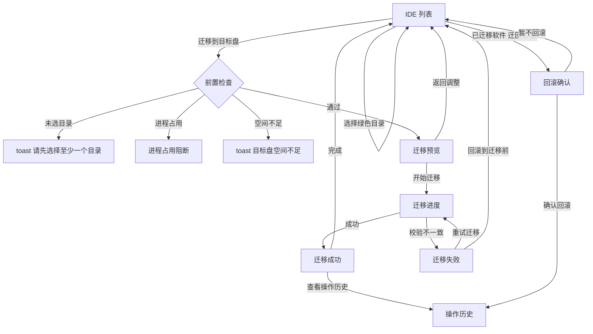

# Disk Warden 界面交互说明 v1.0

> 版本：v1.0
> 日期：2026-10-19
> 负责人：UI/UX 设计师
> 任务：QUOT-6 / T04 高保真交互原型补全
> 状态：可评审（原型已通过浏览器逐路由检查）
> 上游依据：
> - `docs/功能需求.md` v0.1
> - `docs/decisions/0001-第一期范围与优先级.md`
> - `docs/specs/产品规格-v1.0.md`
> - `docs/specs/架构设计-v1.0.md`（仅对齐术语与安全不变量）
> - `data/ide-catalog.json`（T03 产物）
> - `docs/目录清单.md`
> 关联产物：
> - `ui/index.html`（纯静态高保真原型）
> - `ui/_shots/routes/*.png`（16 个路由的 1440×900 截图，供评审）
> 范围：只描述原型可感知的界面结构、交互结果与文案；不定义扫描、复制、校验、建链的实现方式。

---

## 0. 结论摘要

1. 5 个 Tab 全部有真实内容结构：IDE 数据、项目目录、C 盘全景、规则学习、操作历史，没有"无列表"占位。
2. 7 个指定状态全部可独立进入：扫描中、空态、迁移预览、迁移进度、迁移失败、回滚确认、进程占用阻断；另补迁移成功与未知目录确认 2 个状态。
3. 风险分级在列表、详情、预览三处一致：绿色可迁、红色不可动、黄色未知；红色项没有复选框、没有迁移入口，预览中按数量显式排除。
4. 所有界面文案集中在 `ui/index.html` 顶部 `I18N` 对象中，中英文各 519 个键，键集完全一致；渲染代码不含中英文句子。
5. 数据字段结构与 T03 的 `data/ide-catalog.json` 对齐：目录项使用 `path / type / safety / reason / handling`，原型仅额外附加 `size_bytes` 演示体积。
6. 破坏性操作在原型中只做状态演示，不触碰真实文件；所有失败路径都保持"源目录完整"的口径。

---

## 1. 如何打开与评审

### 1.1 打开方式

直接双击 `ui/index.html`，或拖入浏览器。纯静态单文件，无构建、无依赖、无网络请求。

- 设计基准视口：1440×900；最小宽度 1080px。
- 默认语言：中文；可通过 `?lang=en`、侧栏语言按钮或设置弹窗切换。
- 默认路由：`#ide`。

### 1.2 评审入口

右下角"原型状态"悬浮按钮打开状态面板，按三组列出全部 16 个路由：

| 分组 | 路由 |
|---|---|
| IDE 数据 | `#ide`、`#projects`、`#disk`、`#rules`、`#history` |
| 关键状态 | `#ide/scanning`、`#ide/empty`、`#ide/migrate-preview`、`#ide/migrate-progress`、`#ide/migrate-failed`、`#ide/migrate-success`、`#ide/process-blocked`、`#ide/rollback-confirm`、`#ide/yellow-confirm` |
| 其他页面 | `#settings`、`#feedback` |

面板中的路由可点击直达，也可直接改地址栏 hash。`Esc` 关闭面板。

### 1.3 演示数据声明

原型中的软件、目录、体积、进程 PID、历史记录均为假数据，仅用于评审信息密度与状态表达。任何"清理 / 迁移 / 回滚 / 导出 / 打开目录"都不会修改真实文件。

---

## 2. 全局外壳与通用规则

### 2.1 布局

```
┌──────────┬──────────────────────────────────────────────┐
│ 侧栏 212 │ 顶部栏：页面标题 + 扫描信息 + 反馈/重新扫描   │
│          ├──────────────────────────────────────────────┤
│ 5 个导航 │ 4 张统计卡                                    │
│ 系统/设置├──────────────────────────────────────────────┤
│ 语言/版本│ 内容区：左列表 + 右详情（两栏）或单栏         │
└──────────┴──────────────────────────────────────────────┘
```

- 侧栏固定 212px；内容区自适应，`min-width:1080px`。
- 统计卡固定 4 列；窄于 1280px 时列表栏收窄，不改变信息顺序。
- 内容区独立滚动，页面本身不滚动。

### 2.2 侧栏

| 元素 | 行为 |
|---|---|
| 5 个 Tab | 切换 `#ide / #projects / #disk / #rules / #history`；当前项高亮并带 2px 蓝色内阴影 |
| 计数徽标 | IDE 数据 8、项目目录 4、规则学习 3（待确认数）、操作历史 5；C 盘全景不显示计数 |
| 设置 | 打开 `#settings` 弹窗，不切换当前 Tab |
| 语言按钮 | 中文界面显示 `EN`，英文界面显示 `中文`；点击立即整页重渲染 |
| 版本 | `v0.1.0 原型` |

### 2.3 顶部栏

- IDE 数据：显示"上次扫描 2026-10-19 09:42 · 用时 3.4s"与扫描范围 `%APPDATA% · %USERPROFILE% · %LOCALAPPDATA%`；扫描中改为"正在扫描…"。
- 其他 Tab：显示该页一句话说明。
- 右侧固定两个按钮：`反馈问题`（打开 `#feedback`）、`重新扫描`（任意 Tab 均跳 `#ide/scanning`）。

### 2.4 统计卡

每个 Tab 有自己的 4 张卡，卡内包含标签、主值、副说明和迷你进度条。主值使用等宽数字。

| Tab | 4 张卡 |
|---|---|
| IDE 数据 | C 盘剩余、目标盘可用、可释放总量、累计已释放 |
| 项目目录 | 项目总占用、项目数、可回收空间、受保护文件 |
| C 盘全景 | 总容量、已使用、可用空间、可回收估算 |
| 规则学习 | 生效规则、今日命中、待确认目录、冲突策略（红色优先） |
| 操作历史 | 累计已释放、记录数、失败数、可回滚数 |

### 2.5 路由表

| Hash | 呈现 | 说明 |
|---|---|---|
| `#ide` | IDE 数据默认页 | 左软件列表 + 右目录明细 |
| `#projects` | 项目目录 | 左项目列表 + 右项目明细 |
| `#disk` | C 盘全景 | 左分类表 + 右容量条 |
| `#rules` | 规则学习 | 上待确认、下规则表 |
| `#history` | 操作历史 | 左记录列表 + 右详情 |
| `#settings` | 设置弹窗 | 叠加在当前页之上 |
| `#feedback` | 反馈弹窗 | 叠加在当前页之上 |
| `#ide/scanning` | 扫描中 | 单栏进度 + 6 个阶段 |
| `#ide/empty` | 空态 | 未检测到 IDE |
| `#ide/migrate-preview` | 迁移预览弹窗 | 宽弹窗 |
| `#ide/migrate-progress` | 迁移进度弹窗 | 宽弹窗 |
| `#ide/migrate-failed` | 迁移失败弹窗 | 宽弹窗 |
| `#ide/migrate-success` | 迁移成功弹窗 | 宽弹窗 |
| `#ide/process-blocked` | 进程占用阻断弹窗 | 宽弹窗 |
| `#ide/rollback-confirm` | 回滚确认弹窗 | 宽弹窗 |
| `#ide/yellow-confirm` | 未知目录确认弹窗 | 宽弹窗 |

未知 Tab 回退到 `#ide`。深链进入状态路由时，原型会自动补齐可展示的上下文：

- `#ide/process-blocked`：当前软件没有运行进程时，自动切到 Cursor（有 2 个占用进程）。
- `#ide/rollback-confirm`：当前软件未迁移时，自动切到 VS Code，并选中历史记录 h3。
- `#ide/migrate-*`：当前软件已迁移或正在运行时，自动切到 Trae CN（未迁移、无进程）。

### 2.6 弹窗规则

- 弹窗由路由驱动：`#settings`、`#feedback` 以及 7 个 `#ide/*` 状态共用同一套遮罩与容器。
- 打开弹窗前记录来源 hash；关闭（右上角 ✕、取消/返回、点击遮罩）后回到来源页；没有来源时回 `#ide`。
- `Esc` 优先关闭当前弹窗；没有弹窗时关闭"原型状态"面板。
- 点击弹窗内部不会关闭；`role="dialog"`、`aria-modal="true"`、`aria-label` 已标注。
- 迁移预览与进程阻断使用宽弹窗（720px 级别），其余为标准宽度。

### 2.7 可访问性与动效

- 所有可交互元素可键盘聚焦，`:focus-visible` 显示 2px 蓝色轮廓。
- 风险不只靠颜色表达：同时有文字徽标（可迁 / 不可动 / 未知）和符号（⛨ / ?）。
- 开关使用 `role="switch"` 与 `aria-checked`；红色锁定图标带 `aria-label`。
- 遵循 `prefers-reduced-motion`，关闭过渡动画。

---

## 3. 五个 Tab 的界面结构

### 3.1 IDE 数据（`#ide`）

**入口**：默认页；侧栏"IDE 数据"。

**左栏：软件列表**

- 搜索框：按软件名或目录路径实时过滤；无结果时显示"没有符合筛选条件的软件。"
- 筛选：全部 / 在 C 盘 / 已迁移 / 运行中。
- 每行：首字母色块、软件名、运行中徽标、绿/红/黄目录数量、类型（IDE / CLI / 插件 / 工具）、总体积、位置徽标（在 C 盘 / 已迁移）。
- 列表底部为风险图例。

**右栏：目录明细**

- 头部：软件名、根路径、类型、位置、运行中徽标。
- 已迁移横幅：说明数据已在目标盘、通过 junction 链接回原路径，并显示目标路径。
- 进程横幅：列出占用进程名与 PID，并声明不会强制结束进程。
- 目标卡：迁移目标盘 `D:`、目标路径、预计释放、需要空间、目标盘剩余与是否充足、可迁项数量与体积。
- 目录行：
  - 绿色：复选框默认勾选；显示路径、判定原因、体积、`可迁` 徽标、handling 标签。
  - 红色：`⛨` 锁定图标代替复选框；显示 `受保护，无迁移入口`；没有迁移入口。
  - 黄色：复选框禁用；显示 `需确认` 按钮；确认后变为可勾选并显示 `已确认`。
- 底部操作：
  - 未迁移：`迁移到目标盘`（无绿色目录时禁用）、`清理缓存`、`打开目录`、`反馈问题`。
  - 已迁移：`迁回 C 盘`、`打开目录`。
  - 右侧说明：未迁移显示"仅清理 Chromium / 编译缓存，不触碰会话与配置。"；已迁移显示"回滚前请先退出 {app}…"。

**交互结果**

- 点击软件行：切换右侧明细，保留当前筛选与搜索。
- 勾选/取消绿色目录：实时更新预计释放、需要空间、可迁项数量。
- 点击黄色行的 `确认此目录`：打开 `#ide/yellow-confirm`。
- 点击 `迁移到目标盘`：依次检查"是否选了目录 → 是否运行中 → 空间是否足够"，分别进入预览、阻断弹窗或 toast。
- 点击 `清理缓存`：toast 显示释放体积（原型模拟），不改变列表数据。
- 点击 `打开目录`：toast"已在资源管理器中打开（原型模拟）"。

### 3.2 项目目录（`#projects`）

**入口**：侧栏"项目目录"。

**左栏：项目列表**

- 4 个项目：disk-warden、acme-web、data-pipeline、mobile-app。
- 每行：首字母色块（C 盘项目为红色块）、项目名、完整路径、总体积、位置徽标 `C:` / `D:`。
- 点击切换右侧明细。

**右栏：项目明细**

- 头部：项目名、路径、关联 IDE、最近活跃时间。
- 体积卡：依赖、构建产物、`.git`、源码四项。
- 可安全清理：`node_modules` 与构建产物，各带 `清理依赖` / `清理构建产物` 按钮。
- 必须保留：源码与 `.git`，使用红色风险行与 `⛨` 锁，没有清理入口。
- 底部：`清理缓存`（一次清空依赖与构建产物）、`打开目录`；说明"清理后需要重新 npm install / build，Disk Warden 不会自动执行。"

**交互结果**

- 单行清理：对应体积归零，toast 显示释放量，统计卡与项目总量同步更新。
- 一键清理：依赖与构建产物同时归零，toast 汇总释放量。
- 原型只改内存数据，不执行 npm 命令、不删除目录。

### 3.3 C 盘全景（`#disk`）

**入口**：侧栏"C 盘全景"。

**左栏：空间分布**

- 8 个类别：AI IDE 与 CLI、命令行工具、Git worktree、开发工具缓存、JetBrains 缓存、系统与浏览器、临时文件、模型与大文件。
- 每行：色块、类别名、一句说明、体积、处理方式标签（Junction 迁移 / 改环境变量 / 改应用配置 / Docker 设置 / 系统提供方 / 直接清理）、`查看位置`。
- `查看位置` 只弹 toast，不打开资源管理器。

**右栏：容量条**

- 标题 `C: · 120 GB`，副标题显示已用百分比。
- 6 段容量条：AI IDE、开发工具、系统、模型、其他、可用；图例显示每段体积。
- 两条示例风险行：绿色"IE 与 CLI"（Junction 迁移，软件无感知）、黄色"系统与浏览器"（受保护，不在处理范围）。
- 底部：`刷新占用`（toast 模拟）、`IDE 数据`（跳 `#ide`）；说明系统文件、页面文件与受保护目录不在处理范围内，工具不做杀毒或系统优化。

### 3.4 规则学习（`#rules`）

**入口**：侧栏"规则学习"。

**上栏：待确认目录**

- 3 条黄色记录：`.trae-cn`、`.trae`、`.dsh\profiles`，显示识别依据、所属软件、体积。
- 每条三个动作：`标为可迁`、`标为不可动`、`忽略`。
- 处理结果：
  - 标为可迁 / 不可动：从待确认列表移除，并在规则表顶部新增一条"用户学习"的精确规则（匹配条件为路径最后一段）。
  - 忽略：只从列表移除，不新增规则。
- 底部固定提示："当多条规则命中同一路径时，红色永远优先。"

**下栏：规则表**

- 新增规则表单：匹配条件（必填）、匹配方式（精确 / 通配 / 正则）、判定（可迁 / 不可动）、判定原因（可留空）、`添加规则`。
- 必填校验：匹配条件为空时聚焦输入框并 toast"请填写匹配条件"，不新增行。
- 22 条内置/学习规则：匹配、匹配方式、判定、来源、命中次数、启停开关、删除。
- 停用规则不计入"生效规则"统计；删除立即从表格移除。
- 最后一条 `.trae-cn` 为停用的红色用户规则，用于展示"红色优先"与停用态。

### 3.5 操作历史（`#history`）

**入口**：侧栏"操作历史"；迁移成功后"查看操作历史"；回滚完成后自动进入。

**左栏：记录列表**

- 筛选：全部 / 迁移 / 清理 / 回滚。
- 5 条记录：Kiro 迁移成功、Cursor 缓存清理、VS Code 迁移成功（可回滚）、Trae CN 迁移失败、Windsurf 回滚完成。
- 每行：对象与类型、时间、结果徽标（成功 / 失败 / 已回滚）、释放体积。
- 底部说明："原型中的记录为演示数据"。

**右栏：操作详情**

- 头部：对象名、时间 · 耗时、类型徽标、结果徽标。
- 摘要：释放、耗时、对象。
- 路径卡：源 / 目标；失败记录额外显示错误码 `E_VERIFY_MISMATCH`。
- 结果横幅：成功 / 失败 / 已回滚三种语义，文案来自对应记录。
- 执行步骤时间线：迁移 4 步、清理 1 步、回滚 3 步；失败记录最后一步为红色 ✕。
- 底部：可回滚记录显示 `迁回 C 盘`，否则显示禁用的"该操作不可回滚"；`导出记录` 只 toast 模拟；右侧说明"此操作可回滚"或"原型中的记录为演示数据"。

**交互结果**

- 切换筛选时，如果当前记录不属于该类型，自动选中该类型第一条。
- 点击可回滚记录 → 打开 `#ide/rollback-confirm`，关闭后回到 `#history`。
- 回滚确认后：新增一条"已回滚"记录，自动选中并跳到 `#history`，toast"回滚流程已启动（原型模拟）"。

---

## 4. 关键状态与流转

### 4.1 主流程图



### 4.2 状态 S1：扫描中（`#ide/scanning`）

- **入口**：顶部 `重新扫描`；状态面板。
- **画面**：标题、只读声明、62% 进度条、6 个阶段（枚举目录、匹配软件、统计大小、检测进程、应用规则、生成结果）；当前阶段为"统计目录大小 / 进行中"，前两阶段"完成"，后三阶段"等待"；下方骨架屏。
- **按钮**：`取消扫描` → 回 `#ide`，toast"已取消扫描"。
- **流转**：原型定格在 62%，不自动完成；真实实现由扫描任务进度驱动，完成后回 IDE 列表并刷新计数。

### 4.3 状态 S2：空态（`#ide/empty`）

- **入口**：状态面板；真实产品中由"扫描结果为 0"触发。
- **画面**：`没有检测到已知 IDE`、扫描过的三个路径说明、7 个已支持软件标签 + "已支持 20+ 款"、`重新扫描`、`反馈问题`、扫描范围。
- **流转**：`重新扫描` → `#ide/scanning`；`反馈问题` → `#feedback`。

### 4.4 状态 S3：迁移预览（`#ide/migrate-preview`）

- **入口**：IDE 详情点击 `迁移到目标盘`，且已选目录、无进程占用、空间充足。
- **画面**：
  - 摘要三格：源目录 `C:`、目标目录 `D:`、释放 C 盘体积。
  - 目标卡：目标根目录 `D:\DiskWarden\`、完整目标路径（如 `D:\DiskWarden\TraeCN`）、目标盘剩余 `21.7 GB · 空间充足`、junction 说明。
  - 迁移清单：仅列出被勾选的目录，显示路径、原因、体积。
  - 红色横幅：`受保护项自动排除 · {n} 个红色目录不会被复制、删除或链接。`
  - 黄色横幅：`{n} 个黄色目录未确认，暂不迁移。`
- **按钮**：`返回调整`（关闭弹窗回 `#ide`）、`开始迁移`（无目录或空间不足时禁用）。
- **流转**：`开始迁移` → `#ide/migrate-progress`。

### 4.5 状态 S4：迁移进度（`#ide/migrate-progress`）

- **入口**：预览点击 `开始迁移`；失败页点击 `重试迁移`。
- **画面**：软件名、45%、`7,421 / 16,843 个文件`；6 个阶段（备份配置与凭证清单、复制目录、校验文件数量与总字节、删除源目录、建立 junction、读回链接目标并验证）；前两阶段完成，第三阶段进行中；顶部提示"迁移过程中请不要关闭软件或打开目标软件。"
- **按钮**：`取消` 禁用，左侧说明"迁移开始后不可取消，避免留下半迁移状态。"
- **流转**：原型不自动推进；真实实现由任务事件推动，成功 → S8，校验失败 → S5。

### 4.6 状态 S5：迁移失败（`#ide/migrate-failed`）

- **入口**：状态面板；真实产品中由校验失败触发。
- **画面**：
  - 红色横幅："校验未通过：目标端文件数或总字节与源端不一致。"
  - 三格：错误码 `E_VERIFY_MISMATCH`、耗时 `2m 05s`、释放 `—`。
  - 源目录路径、配置备份路径 `D:\DiskWarden\.backup\TraeCN\2026-10-16-1420`。
  - 绿色横幅："源目录仍然完整，未执行删除与建链。"
  - 建议文案："关闭相关软件后重试；若反复失败，请导出日志并反馈。"
- **按钮**：
  - `查看日志` → toast"已复制到剪贴板（原型模拟）"。
  - `回滚到迁移前` → toast"回滚流程已启动（原型模拟）"并回 `#ide`。
  - `重试迁移` → toast"重试中（原型模拟）"并回进度态。
- **安全口径**：失败时源目录不删除、不建链；至少保留一份完整可读数据。

### 4.7 状态 S6：回滚确认（`#ide/rollback-confirm`）

- **入口**：已迁移软件详情点击 `迁回 C 盘`；操作历史中可回滚记录点击 `迁回 C 盘`；状态面板。
- **画面**：
  - 警告横幅：将删除目标路径处的 junction，把数据迁回 C 盘，然后恢复迁移前的配置备份。
  - 三行位置：数据当前位置（目标盘路径）、迁回位置（原 C 盘路径）、配置备份路径。
  - 提醒："回滚前请先退出 {app}，迁移期间不要启动它。"
- **按钮**：`暂不回滚`（关闭弹窗，回来源页）、`确认回滚`（危险按钮）。
- **结果**：软件状态切回"在 C 盘"，新增一条"已回滚"历史，跳 `#history`，toast"回滚流程已启动（原型模拟）"。
- **说明**：原型中的回滚是即时状态切换，不执行真实复制；真实实现需遵守"任意时刻至少保留一份完整可读数据"。

### 4.8 状态 S7：进程占用阻断（`#ide/process-blocked`）

- **入口**：点击 `迁移到目标盘` 时检测到运行中进程（Cursor 默认场景）；状态面板。
- **画面**：
  - 标题 `无法迁移：进程占用`，副标题 `Cursor 正在运行，文件被占用`。
  - 说明：不会强制结束进程，请手动退出后重试。
  - 表格：进程名、PID、占用路径。
    - `Cursor.exe` · 12844 · `%APPDATA%\Cursor\User\globalStorage\state.vscdb`
    - `Cursor Helper.exe` · 15302 · `%APPDATA%\Cursor\Cache\`
  - 提示："退出软件后点击「重新检测」，或稍后手动迁移。"
- **按钮**：
  - `关闭` → 回来源页。
  - `仍要迁移（不推荐）` → toast"强制迁移可能导致文件损坏或软件异常，原型不提供该操作。"，不进入迁移。
  - `重新检测` → toast"进程仍在运行，迁移继续被阻断。"，弹窗保持打开。
- **安全口径**：进程占用是阻断级，高于空间警告；不提供强制迁移。

### 4.9 状态 S8：迁移成功（`#ide/migrate-success`）

- **入口**：状态面板；真实产品中由迁移任务完成触发。
- **画面**：绿色横幅"源路径已建立 junction，软件可照常启动"；三格：已释放 C 盘、校验结果"文件数与字节数一致"、耗时 `3m 41s`；链接目标完整路径；junction 说明。
- **按钮**：`查看操作历史`（跳 `#history`）、`完成`（关闭回 `#ide`）。

### 4.10 状态 S9：未知目录确认（`#ide/yellow-confirm`）

- **入口**：IDE 详情黄色目录行的 `确认此目录`；状态面板。
- **画面**：黄色横幅说明"规则未覆盖该目录，请确认用途后再决定是否允许迁移"，并提醒"如果它包含登录凭证、配置或记忆，请标为「不可动」。"；三格：当前大小、识别依据、风险（未知）；路径行。
- **按钮**：
  - `稍后再说` → 回 `#ide`，不改变状态。
  - `标为不可动` → 该目录转为红色，取消勾选，toast"已标为不可动"，回 `#ide`。
  - `确认可迁移` → 记录确认状态并勾选，toast"已确认，可在迁移预览中勾选"，回 `#ide`。
- **规则联动**：在规则学习页把待确认目录标为可迁/不可动，会新增用户规则；本弹窗只处理当前软件内的目录。

---

## 5. 风险分级与红色保护

### 5.1 三级定义

| 等级 | 颜色 / 符号 | 语义 | 复选框 | 迁移入口 | 典型内容 |
|---|---|---|---|---|---|
| 绿色 | `#22c55e` · 可迁 | 可再生、可重建 | 默认勾选，可取消 | 有 | 缓存、会话、workspaceStorage、日志 |
| 红色 | `#ef4444` · ⛨ 不可动 | 凭证、配置、记忆，动了会丢 | 没有复选框，只有锁图标 | 没有 | Login Data、Local State、settings.json、auth.json、memory |
| 黄色 | `#f59e0b` · ? 未知 | 规则未覆盖，需用户确认 | 确认前禁用，确认后可勾选 | 确认后才可进入清单 | `.trae-cn`、`.trae`、`.dsh\profiles` |

### 5.2 红色保护的三层实现

1. **数据/模型层**：`isChecked()` 对 `safety === 'red'` 恒返回 `false`，无论状态里是否有勾选记录；`toggleCheck()` 对红色直接 return。
2. **控件层**：红色行不渲染复选框，改渲染 `⛨` 锁定图标；红色目录行没有"确认/迁移"类按钮；详情页对红色数量给出显式横幅。
3. **预览层**：预览清单由 `selectedDirs()` 生成，红色永远不会进入；同时显示"受保护项自动排除 + 数量"，让用户知道被排除了多少。

规则冲突时红色永远优先：同一路径同时命中绿色与红色规则，判定为红色。原型规则表底部与规则学习页横幅都明确此策略。

### 5.3 选择与空间计算

- 只有绿色默认选中；确认后的黄色可手动勾选。
- 预计释放 = 已勾选目录 `size_bytes` 之和。
- 需要空间 = `ceil(已选体积 × 1.05 + 64 MiB)`（5% 复制余量 + 64 MiB 缓冲），与产品规格一致。
- 目标盘可用空间读取 `D:` 的演示值 21.7 GB；不足时详情页标红、预览按钮禁用、点击迁移给 toast。
- 体积换算以 1024 为基数，显示单位 GB，内部按字节计算。

### 5.4 目标路径规则

- 目标根目录默认 `D:\DiskWarden\`，可在设置中修改。
- 目标路径 = 根目录去掉末尾反斜杠 + `\` + 软件名去空格：
  - Cursor → `D:\DiskWarden\Cursor`
  - Trae CN → `D:\DiskWarden\TraeCN`
  - VS Code → `D:\DiskWarden\VSCode`
- 已迁移软件使用其运行态记录的目标路径（Windsurf / Kiro / VS Code）。

---

## 6. 按钮 → 结果矩阵

### 6.1 全局

| 位置 | 按钮 | 前置条件 | 结果 |
|---|---|---|---|
| 顶部栏 | 反馈问题 | — | 打开 `#feedback` |
| 顶部栏 | 重新扫描 | — | 进入 `#ide/scanning` |
| 侧栏 | 5 个 Tab | — | 切换路由，清除弹窗返回点 |
| 侧栏 | 设置 | — | 打开 `#settings` |
| 侧栏 | 语言按钮 | — | 中英切换并重渲染 |
| 任何弹窗 | ✕ / 遮罩 | — | 关闭并回来源页或 `#ide` |

### 6.2 IDE 数据

| 按钮 | 前置条件 | 结果 |
|---|---|---|
| 搜索框输入 | — | 实时过滤软件名与路径 |
| 全部 / 在 C 盘 / 已迁移 / 运行中 | — | 过滤列表；无结果给空提示 |
| 软件行 | — | 切换右侧明细 |
| 绿色复选框 | 绿色目录 | 勾选/取消，刷新空间与清单 |
| 黄色复选框 | 已确认 | 勾选/取消 |
| 黄色复选框 | 未确认 | 禁用，不可点 |
| 红色锁图标 | — | 无动作，仅提示受保护 |
| 确认此目录 | 黄色目录 | 打开 `#ide/yellow-confirm` |
| 迁移到目标盘 | 无绿色目录 | 按钮禁用 |
| 迁移到目标盘 | 已选目录但软件运行中 | 打开 `#ide/process-blocked` |
| 迁移到目标盘 | 空间不足 | toast"目标盘空间不足"，停留当前页 |
| 迁移到目标盘 | 校验通过 | 打开 `#ide/migrate-preview` |
| 清理缓存 | — | toast 释放量，不改变数据 |
| 打开目录 | — | toast 模拟 |
| 迁回 C 盘 | 已迁移 | 打开 `#ide/rollback-confirm` |

### 6.3 各状态弹窗

| 按钮 | 结果 |
|---|---|
| 预览 · 返回调整 | 关闭弹窗回 `#ide` |
| 预览 · 开始迁移 | 进入 `#ide/migrate-progress`；无目录/空间不足时禁用 |
| 进度 · 取消 | 禁用；说明"开始后不可取消" |
| 失败 · 查看日志 | toast 模拟复制 |
| 失败 · 回滚到迁移前 | toast 回滚启动，回 `#ide` |
| 失败 · 重试迁移 | toast 重试，回进度态 |
| 成功 · 查看操作历史 | 进入 `#history` |
| 成功 · 完成 | 关闭回 `#ide` |
| 阻断 · 关闭 | 关闭回来源页 |
| 阻断 · 仍要迁移（不推荐） | toast 说明不提供强制迁移，弹窗不关闭 |
| 阻断 · 重新检测 | toast 仍被阻断，弹窗不关闭 |
| 回滚 · 暂不回滚 | 关闭回来源页 |
| 回滚 · 确认回滚 | 状态切回 C 盘，新增历史，跳 `#history` |
| 黄确认 · 稍后再说 | 回 `#ide`，不变更 |
| 黄确认 · 标为不可动 | 目录转红，取消勾选，toast，回 `#ide` |
| 黄确认 · 确认可迁移 | 记录确认并勾选，toast，回 `#ide` |

### 6.4 其他页面

| 页面 | 按钮 | 结果 |
|---|---|---|
| 项目目录 | 清理依赖 / 清理构建产物 / 清理缓存 | 对应体积归零，toast 释放量，统计同步 |
| 项目目录 | 打开目录 | toast 模拟 |
| C 盘全景 | 查看位置 | toast 模拟 |
| C 盘全景 | 刷新占用 | toast"扫描完成"（模拟） |
| C 盘全景 | IDE 数据 | 跳 `#ide` |
| 规则学习 | 标为可迁 / 标为不可动 | 移除待确认项 + 新增用户规则 + toast |
| 规则学习 | 忽略 | 移除待确认项 + toast |
| 规则学习 | 添加规则 | 校验通过则插入表首并立即生效；为空则 toast 并聚焦 |
| 规则学习 | 启停开关 | 切换启用状态，统计同步 |
| 规则学习 | 删除 | 移除规则并 toast |
| 操作历史 | 筛选 | 切换类型，必要时自动选中首条 |
| 操作历史 | 迁回 C 盘 | 打开回滚确认，取消后回历史页 |
| 操作历史 | 导出记录 | toast 模拟 |

### 6.5 设置与反馈

| 按钮 | 结果 |
|---|---|
| 设置 · 语言下拉 | 立即切换语言，弹窗保持打开 |
| 设置 · 目标根目录输入 | 保存后用于预览与详情页的目标路径 |
| 设置 · 开机自启 / 自动维护开关 | 当前会话内切换，刷新后复位 |
| 设置 · 卸载处理方式 | 保留数据并移除链接 / 同时删除迁移数据 |
| 设置 · 保存 | toast"设置已保存"，关闭弹窗 |
| 设置 · 取消 | 关闭弹窗，不保存输入 |
| 反馈 · 复制诊断 | 写入剪贴板并 toast"诊断信息已复制" |
| 反馈 · 提 Issue | toast"已打开 Issue 页面（原型模拟）" |
| 反馈 · 关闭 | 关闭弹窗 |

---

## 7. 异常与提示文案

### 7.1 阻断与失败

| 触发 | 形式 | 中文 | English |
|---|---|---|---|
| 未选目录就迁移 | toast | 请先选择至少一个目录 | Select at least one folder first |
| 软件运行中 | 宽弹窗 | 无法迁移：进程占用 / {app} 正在运行，文件被占用 | Cannot migrate: process in use / {app} is running and files are locked |
| 重新检测仍运行 | toast | 进程仍在运行，迁移继续被阻断。 | The process is still running. Migration stays blocked. |
| 点击强制迁移 | toast | 强制迁移可能导致文件损坏或软件异常，原型不提供该操作。 | Force migration can corrupt files or break the app. The prototype does not offer it. |
| 目标盘空间不足 | toast | 目标盘空间不足 | Not enough space on target |
| 校验不一致 | 失败弹窗 | 校验未通过：目标端文件数或总字节与源端不一致。 | Verification failed: file count or total bytes differ between source and target. |
| 失败后源数据状态 | 成功色横幅 | 源目录仍然完整，未执行删除与建链。 | Source is intact. Delete and link steps were not run. |
| 迁移中取消 | 按钮禁用 + 说明 | 迁移开始后不可取消，避免留下半迁移状态。 | Migration cannot be cancelled once started, to avoid a half-moved state. |
| 规则匹配为空 | toast | 请填写匹配条件 | Enter a match pattern |

### 7.2 预览与风险提示

| 触发 | 中文 | English |
|---|---|---|
| 红色目录被排除 | 受保护项自动排除 · {n} 个红色目录不会被复制、删除或链接。 | Protected items excluded · {n} red folders will not be copied, deleted or linked. |
| 黄色目录未确认 | {n} 个黄色目录未确认，暂不迁移。 | {n} unknown folders are unconfirmed and stay put. |
| 红色行说明 | 受保护，无迁移入口 | Protected, no migration entry |
| 黄色未确认行 | 需先确认此目录的用途 | Confirm what this folder is first |
| 规则冲突 | 当多条规则命中同一路径时，红色永远优先。 | When several rules hit the same path, red always wins. |

### 7.3 模拟类反馈

| 触发 | 中文 | English |
|---|---|---|
| 清理缓存 | 缓存清理完成，释放 {size}（原型模拟） | Cache cleaned, freed {size} (prototype simulation) |
| 打开目录 | 已在资源管理器中打开（原型模拟） | Opened in Explorer (prototype simulation) |
| 导出记录 | 记录已导出（原型模拟） | Records exported (prototype simulation) |
| 回滚启动 | 回滚流程已启动（原型模拟） | Rollback started (prototype simulation) |
| 重试迁移 | 重试中（原型模拟） | Retrying (prototype simulation) |
| 复制诊断 | 诊断信息已复制 | Diagnostics copied |
| 黄色目录已确认 | 已确认，可在迁移预览中勾选 | Confirmed. You can select it in the preview. |

### 7.4 文案原则

- 失败文案先讲"发生了什么"，再讲"源数据是否安全"，最后给"下一步"。
- 阻断文案不指责用户，不提供危险的默认动作；强制选项从措辞上就标注"不推荐"且实际不可执行。
- 所有"原型模拟"字样在交付真实实现时移除，对应 i18n 键保留位置不变。

---

## 8. i18n 组织

### 8.1 结构

- 单文件顶部定义 `I18N['zh-CN']` 与 `I18N['en']`，每个键对应一句完整文案。
- 渲染代码只调用 `t(key, vars)`，不拼接句子；动态部分通过 `{name}` 占位符插值。
- 回退顺序：当前语言 → `zh-CN` → 返回键名（便于评审发现漏配）。
- 当前规模：中英文各 **519 个键**，键集完全一致（missingEn = []，extraEn = []）。
- 文案按命名空间组织：`app / nav / page / meta / action / common / legend / stats / ide / reason / preview / progress / failed / success / rollback / blocked / yellow / scan / empty / settings / feedback / projects / disk / rules / history / toast / proto / unit`。

### 8.2 切换与持久化

- 侧栏语言按钮：中文界面显示 `EN`，英文界面显示 `中文`。
- 设置弹窗语言下拉：即时生效，弹窗不关闭。
- URL 参数 `?lang=en` 优先于本地存储。
- 选择写入 `localStorage['dw-lang']`；刷新后保持。
- 切换时同步更新 `<html lang>`、页面标题、侧栏、统计卡、当前页面与弹窗。

### 8.3 不进入 i18n 的内容

以下属于数据或技术标识，不做翻译：软件名、目录路径、环境变量、进程名、PID、错误码、盘符、体积单位 `GB`、演示时间戳、handling 代码值（如 `junction`）。这些值由扫描引擎或规则数据提供，不属于界面文案。

---

## 9. 与 T03 数据结构对齐

### 9.1 顶层结构

```json
{
  "schema_version": 1,
  "source": "ui prototype (aligned with data/ide-catalog.json)",
  "platform": "windows",
  "updated_at": "2026-10-19",
  "ides": []
}
```

与 `data/ide-catalog.json` 的 `schema_version / source / platform / updated_at / ides` 一致。

### 9.2 IDE 与目录字段

| 层级 | 字段 | 原型 | T03 | 说明 |
|---|---|---|---|---|
| IDE | `id` | 有 | 有 | 稳定标识，用于路由与选择状态 |
| IDE | `name` | 有 | 有 | 展示名 |
| IDE | `kind` | 有 | 有 | `ide / cli / extension / tool` |
| IDE | `platform` | 有 | 有 | 固定 `windows` |
| IDE | `processes` | 有 | 有 | 进程名列表，用于占用检测展示 |
| IDE | `notes` | 省略 | 有 | 原型不渲染官方说明；接入真实数据时原样透传，不参与判定 |
| IDE | `directories` | 有 | 有 | 目录项数组 |
| 目录 | `path` | 有 | 有 | 支持环境变量前缀与末尾反斜杠 |
| 目录 | `type` | 有 | 有 | 原型使用 `file / dir`；T03 另有 `glob` |
| 目录 | `safety` | 有 | 有 | `green / red / yellow` |
| 目录 | `reason` | 有 | 有 | 原型存 i18n 键（如 `reason.chatDb`）；T03 存中文说明 |
| 目录 | `handling` | 部分有 | 部分有 | 原型绿色项标 `junction`；红色项省略 |
| 目录 | `size_bytes` | 有 | 无 | 原型附加的演示体积；真实实现由扫描引擎填充 |

### 9.3 原型数据规模

- 8 款软件（T03 全量为 30 款），覆盖 IDE 与 CLI 两类：
  - Cursor、Trae CN、Trae、Windsurf、Kiro、VS Code、Claude Code、Codex CLI。
- 42 个目录项：绿色 26、红色 14、黄色 2。
- 运行态独立于目录数据：`root / location / migrated / target / running`，由扫描与迁移任务写入，不混入 catalog。

### 9.4 对齐方式说明

- `reason` 使用键而不是中文句子，是为了满足"所有界面文案集中管理"；键与 T03 的中文说明一一对应，真实接入时可在数据层做映射。
- 原型只保留可演示的字段子集；T03 的 `notes` 与 `glob` 目录项在原型中不出现，但字段名与语义不变。
- 扫描结果进入界面时应保持同一结构，不在渲染层重命名字段。

---

## 10. 验收对照、已知限制与交接

### 10.1 T04 验收对照

| 验收项 | 结果 | 证据 |
|---|---|---|
| 5 个 Tab 都有真实内容结构 | 通过 | `#ide` 列表+明细、`#projects` 列表+明细、`#disk` 分类表+容量条、`#rules` 待确认+规则表、`#history` 列表+详情 |
| 扫描中 | 通过 | `#ide/scanning`，6 阶段 + 62% + 取消 |
| 空态（未检测到 IDE） | 通过 | `#ide/empty`，支持列表 + 重新扫描 + 反馈 |
| 迁移预览 | 通过 | `#ide/migrate-preview`，清单 + 空间 + 红色排除 + 黄色待确认 |
| 迁移进度 | 通过 | `#ide/migrate-progress`，6 阶段 + 文件计数 + 不可取消说明 |
| 迁移失败 | 通过 | `#ide/migrate-failed`，错误码 + 源目录安全 + 重试/回滚/日志 |
| 回滚确认 | 通过 | `#ide/rollback-confirm`，位置对照 + 备份路径 + 退出提醒 |
| 进程占用阻断 | 通过 | `#ide/process-blocked`，进程/PID/占用路径 + 不强制结束 |
| 风险分级可见 | 通过 | 三级徽标 + 图例 + 红色锁 + 黄色确认 |
| 红色没有迁移入口 | 通过 | 无复选框、无迁移按钮、预览排除并计数 |
| 文案集中在脚本顶部 | 通过 | `I18N` 对象，中英各 519 键，键集一致 |
| 中英文默认值都有 | 通过 | `zh-CN` 与 `en` 全量键 |
| 交互说明覆盖入口/流转/按钮/异常 | 通过 | 本文第 2–7 章 |
| 字段结构对齐 T03 | 通过（含说明） | 第 9 章；差异仅 `notes`、`glob`、`size_bytes` |

浏览器检查：16 个路由均正常渲染，无 JS 错误，无 `undefined/NaN`，1440×900 无横向溢出；关键交互探针全部通过。

### 10.2 已知限制

1. **演示数据**：软件、目录、体积、历史、进程均为假数据，不代表真实机器。
2. **无后端/IPC**：不读取文件系统、不执行复制/删除/建链，所有破坏性操作只改内存或弹 toast。
3. **状态不持久化**：除语言外，刷新后选择、规则、设置、历史均复位。
4. **进度不自动推进**：扫描与迁移定格在演示进度，便于评审截图；真实实现需接任务事件。
5. **进度弹窗仍可关闭**：底部取消按钮已禁用，但右上角 ✕ 与遮罩仍能退出演示；真实实现应在任务进行中禁用关闭。
6. **预览 5 分钟有效期未实现**：产品规格要求预览 5 分钟内有效，原型未做倒计时与失效。
7. **异常画面不完整**：权限不足、迁移中断、回滚失败三种异常在原型中没有独立画面；以"失败态 + 源目录完整"作为兜底示意，完整流程由 T06–T08 按产品规格实现。
8. **规则匹配为演示**：新增/停用/删除规则不会重新扫描目录，只影响表格与统计。
9. **目标根目录校验**：设置中允许任意文本，未校验盘符存在性、可写性与根目录合法性。
10. **导出/打开目录/提 Issue**：仅 toast 模拟，不产生真实文件或外部跳转。

### 10.3 交接建议

- **T06 扫描**：按第 9 章结构产出 catalog 与运行态；扫描进度接入 S1 的 6 个阶段。
- **T07 迁移**：复用 S3/S4/S5/S8 的字段与文案；落实"校验不通过不动源数据"、预览 5 分钟有效、单写任务、不申请提权。
- **T08 回滚**：复用 S6 的确认信息与安全口径；回滚失败需要新增独立状态与文案。
- **T12 测试**：按第 10.1 节逐项验收；异常场景补权限不足、中断、回滚失败。
- **设计还原**：以 `ui/_shots/routes/` 截图与本文为基线；组件尺寸、颜色、间距以 `ui/index.html` 的 CSS Token 为准。

---

## 变更记录

| 版本 | 日期 | 变更 |
|---|---|---|
| v1.0 | 2026-10-19 | 首版：覆盖 5 个 Tab、9 个关键状态、风险模型、按钮矩阵、异常文案、i18n 与 T03 字段对齐 |
